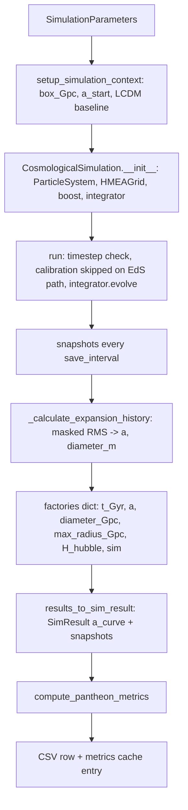

# Data flow — one simulation, one sweep cell

Modules: [module-structure.md](./module-structure.md). Physics of each stage:
[../physics/initial-conditions.md](../physics/initial-conditions.md),
[../physics/integration.md](../physics/integration.md),
[../physics/hubble-diagram.md](../physics/hubble-diagram.md).



## Stage contracts
1. **Context**: `setup_simulation_context(t_start, t_duration, n_steps, save_interval)` →
   box diameter (14.5 Gpc × a_start/a_today), a_start, analytic ΛCDM baseline at the exact
   snapshot times.
2. **Build**: `CosmologicalSimulation(sim_params, box_size_Gpc, a_start, use_external_nodes,
   use_dark_energy, force_method)` seeds `np.random` with `seed`, scales the box by
   `start_size_scale`, builds particles (inner first, then outer shell), the HMEA grid, applies
   the pre-start boost, and creates the integrator (softening 1 Gpc base).
3. **Run**: `run(t_end_Gyr=duration, n_steps, save_interval, damping)`; the calibration runs only
   off the EdS path; `evolve` returns snapshots `{time_s, positions, velocities, accelerations}`
   for ALL particles.
4. **Measure**: `expansion_history` entries `{time, time_Gyr, scale_factor, diameter_m, size_a,
   max_particle_distance, com}` computed on the observable (inner) particles only;
   `scale_factor[0] == 1`.
5. **Package**: `run_external_node_simulation` returns the factories dict; `results_to_sim_result`
   wraps it as `SimResult(size_curve_Gpc, hubble_curve, t_Gyr, params, results, a_curve,
   snapshots)`; snapshots ride along only for post-sim scoring.
6. **Score**: growth anchor → μ(z) χ² on in-range SNe → optional best observer, fractions, knot
   ratio (see [../scripts/sweep.md](../scripts/sweep.md)).
7. **Persist**: metrics + small results in `data/metrics_*.csv`; tidy row in
   `results/ws1_sweep_<tag>.csv`; optional `results/hero/<tag>.npz`.

## Single-run entry points
- `run_simulation.py` — External-Node + matter-only N-body + analytic ΛCDM, 4-panel plot.
- `hubble_diagram_nbody.py` — one config scored against Pantheon+ with a JSON sidecar.
- Direct use (tests, figure scripts): the factories functions above.

## Units at the boundaries
SI inside (m, s, kg); Gpc/Gyr only at I/O. `diameter_*` = 2 × RMS radius. Snapshot times are
relative to t_start. See [../practices/unit-conventions.md](../practices/unit-conventions.md).

```python
res = run_external_node_simulation(p, box_Gpc, a_start, save_interval=10)
sr = results_to_sim_result(res, p)
m = compute_pantheon_metrics(sr, load_pantheon(), p.t_start_Gyr, score_observers=True,
                             lcdm_ref=0.436, eds_ref=0.843, n_inner=p.n_particles)
```
