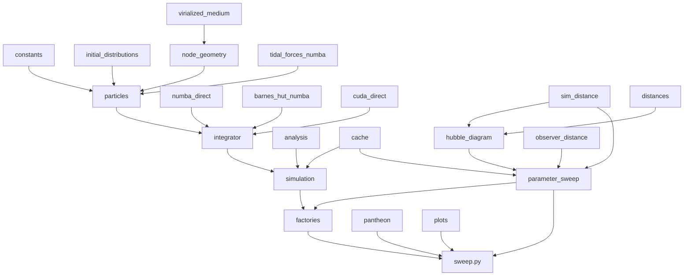

# Module structure

Pure-Python package `cosmo/` (numpy, scipy, numba, matplotlib, tqdm; no install step, scripts run
from the repo root) plus root scripts. How data moves through it: [data-flow.md](./data-flow.md).


(`constants` also imports `node_geometry` lazily inside `ExternalNodeParameters.build_virialized`.)

## cosmo/ — simulation core
| module | owns |
|---|---|
| `constants.py` | SI constants (`Gyr_to_s` = 365-day year), `LambdaCDMParameters` (H0 70, Ω 0.3/0.7, `H_eds_at_time`), `ExternalNodeParameters` (node masses/scale factors, Ω_Λ,eff), `SimulationParameters` (every knob, validation, derived SI values), force-law codes |
| `particles.py` | `Particle`, `ParticleSystem` (EdS ICs, samplers, outer shell, observable mask), `HMEAGrid` (geometry → nodes, tidal batch) |
| `initial_distributions.py` | `sample_grf` (BBKS + Zel'dovich), `sample_grf_mass`, GRF diagnostics |
| `node_geometry.py` | geometry registry, `build_virialized_grid` (lattice/gradient/medium), NN spacing, legacy force-balance metric |
| `virialized_medium.py` | periodic medium relaxation, `virial_ratio` |
| `tidal_forces_numba.py`, `numba_direct.py`, `barnes_hut_numba.py`, `cuda_direct.py` | force kernels |
| `integrator.py` | `LeapfrogIntegrator`: force dispatch, KDK with force reuse, sub-steps, chunked PE |
| `simulation.py` | `CosmologicalSimulation`: wiring, pre-start boost, legacy calibration, masked a(t) |
| `factories.py` | `setup_simulation_context`, `run_external_node_simulation`, `run_matter_only_simulation`, `results_to_sim_result` |
| `analysis.py` | Friedmann solvers, initial box, R², H(t) from a(t), runaway / COM checks |

## cosmo/ — scoring, sweep, output
| module | owns |
|---|---|
| `sim_distance.py` | a(t) → μ(z) |
| `distances.py` | analytic H(z), d_L, μ for lcdm / matter_only / einstein_de_sitter / external_node |
| `pantheon.py` | Pantheon+ loader, plot binning |
| `hubble_diagram.py` | offset fit, χ² engine |
| `observer_distance.py` | per-particle observers |
| `anisotropy.py` | shear, dipole, axis RMS |
| `parameter_sweep.py` | `SweepConfig`, scorers, S searches, `build_cache_name`, `PHYSICS_CACHE_VERSION`, knot ratio |
| `cache.py` | CSV/JSON/pickle two-level cache, PID locks, concurrent merge mode |
| `plots.py`, `visualization.py` | figure helpers |
| `cli.py` | shared argparse knobs → `args_to_sim_params` (all sim knobs reach the sim) |
| `encoding.py` | `configure_utf8_stdout` for Windows consoles |

## Root
`sweep.py` (THE sweep driver), `run_simulation.py`, `hubble_diagram_nbody.py`,
`hubble_diagram.py`, `anisotropy_report.py`, `convergence_check.py`, `compute_predictions.py`,
figure scripts (`_generate_*`, `_gen_*`, see [../scripts/visualization.md](../scripts/visualization.md)),
`launch_sweep_detached.ps1`, `sweeps/` (JSON configs + `_gen_*` generators + verdict scripts),
`hf/` (HuggingFace Dataset push + Gradio Space scaffold), `docs/` (paper + figures), `data/`
(Pantheon+ README, tracked medium caches; metrics CSVs are gitignored).

```python
from cosmo.constants import SimulationParameters          # 1. parameters
from cosmo.factories import setup_simulation_context, run_external_node_simulation
from cosmo.parameter_sweep import compute_pantheon_metrics  # 3. scoring
```
