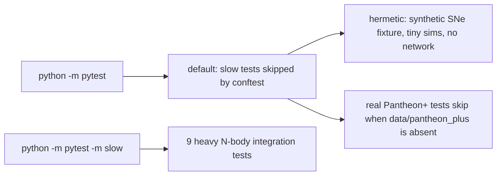

# Testing

~1320 pytest tests in `tests/` (unittest classes + plain functions), ~1.5 min for the default
run. Physics-first: pin invariants and contracts (PF1, mean preservation, keyed==run,
bit-identity of refactors), not implementation details. Practices: [../practices.md](../practices.md).



## Running
```bash
python -m pytest -q                         # everything except @pytest.mark.slow
python -m pytest -m slow -q                 # only the slow ones
python -m pytest tests/test_force_reuse.py -q
```
`conftest.py` registers the `slow` marker and skips slow tests unless a `-m` expression is given.

## Map (by area)
| area | files |
|---|---|
| constants, units, radius-vs-diameter | `test_constants`, `test_units_validation`, `test_radius_diameter_semantics` |
| ICs, PF1, samplers, start size, boost | `test_matter_only_consistency`, `test_particles`, `test_realistic_init`, `test_grfmass`, `test_start_size`, `test_pre_start_tidal_boost`, `test_early_time_behavior`, `test_early_start_validation` |
| forces + kernels | `test_forces`, `test_tidal_numba`, `test_barnes_hut`, `test_cuda_direct` (CUDA simulator subprocess), `test_slingshot`, `test_node_masses`, `test_node_s_amplitude` |
| integrator | `test_integrator`, `test_force_reuse` (bit-identical oracle), `test_potential_energy_memory` |
| geometry | `test_node_geometry`, `test_node_geometry_anisotropy`, `test_virialized_grid`, `test_virialized_medium`, `test_virialization_validation` |
| centerM / mask | `test_observable_mask`, `test_ws4_cache_slug` |
| scoring | `test_sim_distance`, `test_distances`, `test_pantheon`, `test_hubble_diagram*`, `test_observer_distance`, `test_anisotropy`, `test_hubble_parameter`, `test_friedmann_at_times`, `test_simulation_baseline` |
| sweep + cache | `test_overarching_sweep` (driver, keyed==run per knob, families, observers, knot guard), `test_parameter_sweep*`, `test_cofit_validation`, `test_sweep_resume`, `test_cache`, `test_cache_concurrent` |
| figures / scripts | `test_plots`, `test_ws8_figs`, `test_virialization_figs`, `test_meta_structure_fig`, `test_visualization`, `test_cli`, `test_encoding`, `test_factories`, `test_model_comparison`, `test_reproducibility`, `test_simulation_quality` |

## Rules
- A physics-preserving refactor ships with an ORACLE test proving bit-identity against the old
  behaviour (e.g. `_TwoEvalLeapfrog` in `test_force_reuse.py`) plus a check that existing sweep
  cells/keys are unchanged.
- A new knob ships with keyed==run tests: the SweepConfig key AND the SimulationParameters the
  sim receives both carry it; default adds no slug.
- Tests that do not depend on the real SNe use `tests/fixtures/pantheon_synthetic.dat`
  (11 SNe, z 0.03–1.5); real-data assertions must skip when the file is absent.
- Stochastic tests seed explicitly (`np.random.seed` for particles, `default_rng` elsewhere).
- Warnings are part of the contract: assert expected ones (`assertWarnsRegex`) so new ones stand out.

```python
@pytest.mark.slow           # heavy: excluded from the default run
def test_n_ladder_converges(): ...
```
