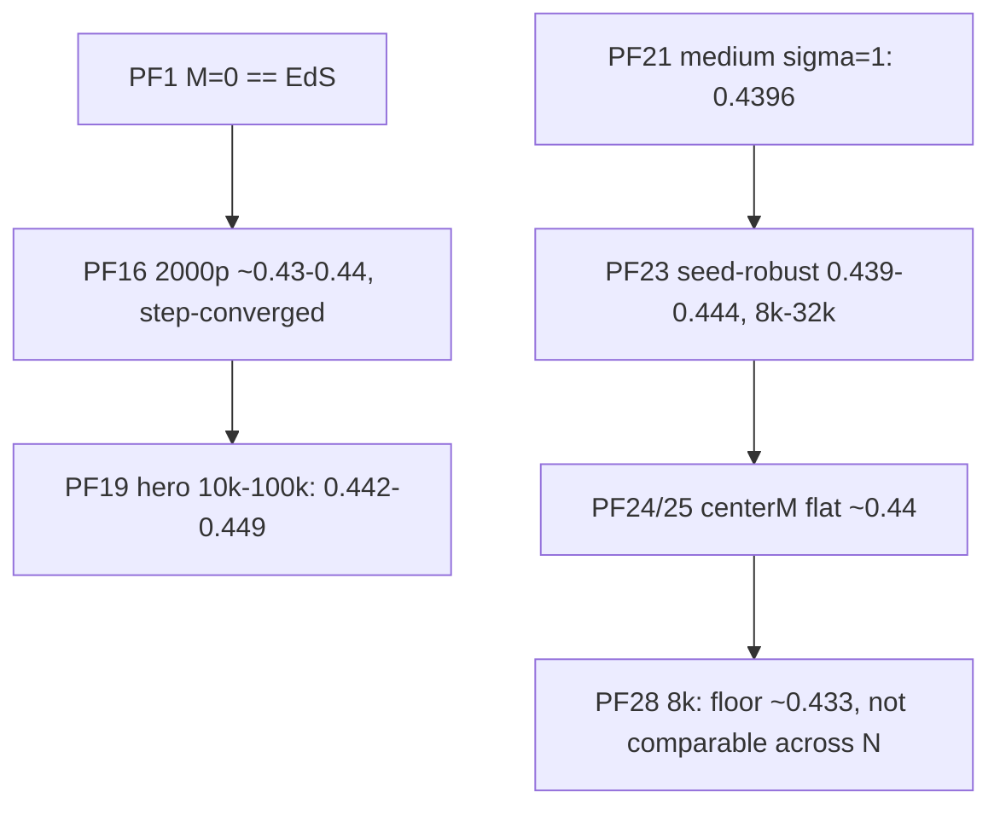

# Findings — the Pantheon+ fit

Index + do-not-claim list: [summary.md](./summary.md). Scoring machinery:
[../physics/hubble-diagram.md](../physics/hubble-diagram.md), observers:
[../physics/observers.md](../physics/observers.md). References everywhere: ΛCDM 0.436, EdS
null 0.843 (χ²/dof, diagonal errors, offset-marginalized), growth anchor ≈3.30× at
t_start=2.9 (window [2.64, 3.97]).



## PF1 — M=0 == Einstein-de Sitter (the invariant)
EdS-consistent ICs (v = H_EdS·r, H_EdS = 2/(3 t_start), cloud mass = ρ_crit·V) make M_ext=0
reproduce EdS: ~0.2–0.3% growth, ~0.02 mag RMS in μ(z); μ(z) sits ON the EdS null. Holds
for any t_start ≥ ~2 Gyr, any start size, uniform/GRF/grfmass init; the pre-start boost and
every node knot vanish at M=0. Test: `tests/test_matter_only_consistency.py`.
**Every new knob/geometry must keep it.** Detail: [../physics/initial-conditions.md](../physics/initial-conditions.md).

## PF3 — isotropic M/S³ degeneracy
SNe constrain the effective expansion, not M and S separately. With S co-fit per M the
χ²/dof is flat along the M/S³ ridge (M≈20→200000 on cube26; M 50→3000 on the medium, higher
M ⇒ higher co-fit S). Report the band + multiplicity, never a "best M". node_mass_amplitude is
a second-order growth nudge degenerate with M/S, not an independent fit knob.

## PF5 — runaway boundary
Small S runs away (nearest-node (S−R)⁻² pull beats bound expansion). Boundary ≈ constant
Ω_Λ,eff contour, S_crit ∝ M^(1/3) (cube26: M 855→S~21, 3000→~24, 5000→~27, 8000→~30). The
growth anchor (`GROWTH_ANCHOR_TOL=0.20`) rejects these cells. Matching total growth with the
wrong a(t) SHAPE is penalized, so the best shape sits at intermediate field strength.

## PF6 / PF24 — outer mass does not move the fit
WS4 outer mass (centerM>1, matter outside the observable sphere) is inert for the isotropic
fit: cube26 small-M grid 0.692→0.680 (centerM 1→2); medium·grfmass best_obs flat 0.439–0.445
(centerM 1→3). Physically: a statistically uniform shell ≈ shell theorem. centerM's real
lever is the PRE-Big-Bang "us" node mass (vir_center_mass_frac): a STRUCTURE lever (PF24,
[structure.md](./structure.md)). Both progenitor branches fit: vcm≈1 → S=55 Gpc, 0.4405;
vcm = centerM/M_value (physical, tiny) → S=93 Gpc, 0.4413. Settled semantics:
[../physics/centerm-outer-mass.md](../physics/centerm-outer-mass.md).

## PF10 — start_size_scale is a shape lever
a(t) is an RMS ratio, so a uniform rescale cancels at M=0 (EdS mass scales with volume), but
at M>0 the cloud spans a different fraction of the fixed S ⇒ different tidal shear ⇒ different
shape: growth 3.07 / 3.38 / 4.73 at scale 0.8 / 1.0 / 1.2 (one test cell). Test:
`tests/test_start_size.py`.

## PF12 — GRF is not broken
The GRF chi² swing (M=1500/S=30 cube26: uniform 0.526 vs grf 1.14) was half a setup bug (the
sampler filled a CUBE with a fat radial tail; fixed: `sample_grf(support="sphere")` default) and
half real clustering (grf-sphere 0.84, flat in N). Weak-field cells: GRF == uniform. The
headline init is now `grfmass` (contrast in masses, PF23).

## PF4 / PF15 — legacy lattice-era numbers (superseded, keep for context)
- PF4: cube26 uniform nodes, 400p/273 steps: best isotropic ~0.52 (band 0.52–0.54, S=20–35).
- PF15: lattice with wide node-mass σ (3–8) avoided small-S cloud collapse and reached ~0.51 at
  600p; led to the high-σ lattice runs of PF16/19. Now disfavoured physically (PF20).

## PF16 — production resolution: ≈ΛCDM for many configs
localized_v4/v5/v7/v8 (virialized lattice 300 nodes, σ 4–8, GRF sphere, Plummer 1 Gpc,
observer_k=-1): best-observer 0.431–0.44 for dozens of (M 100–500, S 15–30, σ) cells.
Step ladder at M300/S20/σ6 (2000p): 1092→0.4396, 1638→0.4339, 2184→0.4317, 3276→0.4313
(converged). N-check 4000p: best 0.4347, centre 0.4414, frac_below_ΛCDM 0.2% (vs 7% at 2000p
= partly sampling tail). Seed spread per cell 0.0007–0.0041. Honest claim: MATCHES ΛCDM.

## PF19 — hero ladder converged in N and dt
| particles | steps | M/S/σ | best-obs | centre | growth |
|---|---|---|---|---|---|
| 10k | 5k | 300/20/6 | 0.4424 | 0.453 | 3.63 |
| 50k | 8k | 300/20/5 | 0.4449 | 0.457 | 3.39 |
| 75k | 11k | 200/22/6 | 0.4491 | 0.541 | 3.09 |
| 100k | 12k | 300/20/6 | 0.4465 | 0.453 | 3.64 |
Only a minority of node seeds are anchor-ok at M300/S20/σ6 (others run away, growth 5.7–6.2),
so "seed-robust" means the anchor-ok subset. frac_below_ΛCDM = 0 at these vantages.

## PF21 / PF23 — the medium fits at defensible low σ
`sweeps/medium/` (σ 1–2, M 50–3000, ternary S co-fit [20,120], 2000p/546): all 15 cells
anchor-ok, none runaway; best σ=1.0·M3000·S63 → 0.4396 (centre 0.458). Void-seed sweep and the
8k→32k knot ladder: best_obs 0.439–0.444 across seeds, σ, GRF realization, N — the fit is
universal; weak-near-field seeds are σ-robust, near-node seeds σ-fragile.

## PF28 — absolute values vs N
8k campaign qualifiers cluster 0.433–0.435 (47/68 ≤ 0.436) vs 2k 0.438–0.442 (0 below). 16k
read ~+0.005 above 2k elsewhere: opposite signs ⇒ observer-sampling noise, not physics. The
N-stable statement is the QUALIFICATION count, not a sub-ΛCDM count. Co-fit S shifts only
+1.0 Gpc median 2k→8k.

## Reading a sweep row (code)
```python
# headline = best observer when score_observers=True; centre kept separately
row["chi2_dof"] == row["best_observer_chi2"]      # PF13 inference
row["center_chi2_dof"]                             # context only
row["anchor_ok"]                                   # growth within 20% of expected_growth_factor
row["frac_below_lcdm"], row["frac_below_eds"]      # genericity (PF13)
```
