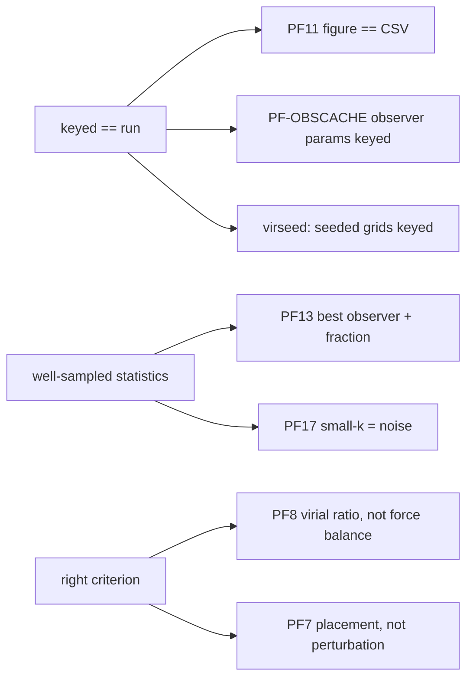

# Findings — measuring honestly (methodology lessons)

Index: [summary.md](./summary.md). These are the traps this project fell into once; each
fix is in code and tested. Practices distilled from them: [../practices.md](../practices.md).



## PF13 — we are a random observer
We are not at the centre (P≈0), and Pantheon+ localises us, so selecting the best-matching
observer is the correct inference, not a cherry-pick. Always report two statistics:
(i) EXISTENCE — best-observer χ²/dof; (ii) GENERICITY — `frac_below_lcdm` / `frac_below_eds`.
Median / centre are context. Wired: `score_observers=True` makes best-observer the headline
`chi2_dof`, centre kept as `center_chi2_dof` ([../physics/observers.md](../physics/observers.md)).

## PF17 — small-k local observers are noise
observer_k = 64–256 of 2000 tracers gives absurd best values (0.0038, 0.0105: inside the SN
error bars) while median/centre stay ~0.51 and the fraction stays ~1%: the min over ~2000
noisy curves catches a lucky fit. Rule: use `observer_k=-1` (whole cloud) or large k, and
sanity-check best vs median (best ≪ median ⇒ fluke). Local observers need far higher N.

## PF8 / PF21 — force balance is not virialization
A virialized system is held up by velocity dispersion (2K/|U|≈1); only a crystal/glass is
static-force-balanced. The lattice's ~1e-29 centre residual required a central node of one
full HMEA mass (the `center_mass_kg` default); the physical central node ("us", ~centerM ×
observable mass) is tiny — remove it and the lattice reads ~142. Option B (gradient descent
toward force balance) only reached 95/32, never balance. Use the virial ratio on the periodic
medium (`cosmo/virialized_medium.virial_ratio`). `virialization_residual` survives as a
diagnostic only.

## PF7 — placement, not perturbation
Tidal stretch ~1/r³ is near-field dominated. fcc/bcc park most nodes 4–6× beyond the ~14 Gpc
horizon where they are inert, so "S" is not comparable across geometries. The per-node
mass/position perturbation code is correct on every geometry (128 tests,
`tests/test_node_geometry_anisotropy.py`). Cross-geometry (400p, nearest node pinned at S):
cube26 ≈ cube_dense best, bcc middle, fcc worst; only the strong-field regime differs.

## PF9 — slingshot = near-point node close pass
Heavy-tailed particle displacements (max/median ~514× cube26 M1000/S10) vanish with nodes OFF
(~1.3×); more steps or particles don't help. Plummer node softening 1 Gpc: 514→2.8×. Bounded
law + adaptive substep is the best cube26 combination (tail 2.4×, growth in anchor). A
geometric runaway (virialized at extreme M/S) is untamed by any law.
Mechanics: [../physics/forces.md](../physics/forces.md).

## PF11 — one parameter builder for sim and figure
The μ(z) figure once re-ran a cube26/no-softening sim because it hand-built
SimulationParameters (CSV 0.903 vs figure ~0.52 for a virialized cell). Now
`sweep._build_sim_params` feeds both, and `_emit_chi2_reconciliation` requires
|CSV − figure| < 0.01. Quote the CSV value.

## Keyed == run (three real bugs, all fixed)
- **PF-OBSCACHE**: observer_k/sample/definition were not in the metrics-cache key, so a re-run
  with a new observer_k served stale scores. Now `{def}obsdef_{n}obssamp_{k}obsk` when
  score_observers.
- **virseed (B3a)**: seeded virialized grids at amplitude 0 collided on one key and
  `expand_grid` collapsed their seeds to 42. Rule now in `vir_seed_reshapes_grid` (massfunc
  spread>0, or any medium relaxation); `node_s_amplitude>0` also keeps per-seed cells.
- **mu(z) panel** (PF11 above) and the legacy calibration key (start size / softening /
  geometry appended on the non-EdS path).

## PF22 — falsify the numerics you suspect
Barnes-Hut θ=0.5 vs exact `numba_direct` on an identical cell: indistinguishable (0.4541 both).
Any chart can be reproduced without BH via `force_method` (keyed: `numbadirectfm`).

## Resolution discipline
- Best-observer absolute values shift ±0.005–0.01 between particle counts in both directions
  (observer sampling). Compare qualification, not third decimals (PF26/PF28).
- Knot values near a threshold move ±0.08 with N: require margin + high-N confirmation.
- A 4-point grid is a probe, not a sweep; sweeps use ~8+ log-spaced values × seeds.

```python
# sanity check before quoting a best-observer number (cfg = the sweep JSON, row = CSV row)
assert cfg.get("observer_k", -1) == -1                      # whole-cloud (well-sampled) observers
ratio = float(row["best_observer_chi2"]) / float(row["observer_median_chi2"])
assert ratio > 0.5   # rule of thumb: real vantages ~0.8-0.9; PF17 flukes ~0.01
```
