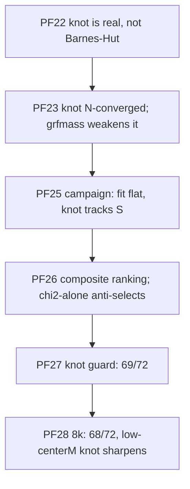

# Findings — anisotropy, the central knot, universe-likeness

Index: [summary.md](./summary.md). Knot metric + guard: [../scripts/sweep.md](../scripts/sweep.md);
medium structure: [../physics/node-geometry.md](../physics/node-geometry.md). The composite
criterion is user-mandated: "best" = best fit to everything we observe, never χ² alone.



## PF2 — anisotropy is the discriminating signal
Rearranging vacuum (∇²Φ=0) node mass is TRACELESS to linear order: shear/dipole only, no
isotropic expansion. Lever experiment (cube26 M1500/S40, 400p): node_mass_amplitude 0→0.5
raised shear 0.20→1.92 and dipole 0.02→0.28 while the anchor-ok isotropic χ² stayed in the
symmetric band (~0.48 min, never below ΛCDM); pushing further tips into runaway. The growth
bump is a 2nd-order near-node (S−R)⁻² effect. Measure with `cosmo/anisotropy.py`
([../physics/anisotropy-diagnostic.md](../physics/anisotropy-diagnostic.md)).

## PF18 — coherent bulk drift
Headline lattice cloud's COM drifts ~30 Gpc over 10.9 Gyr (median-centre 28.9 ≈ mean 30.8 ⇒
the WHOLE cloud translates). A bulk translation is unobservable from inside and does not
touch a(t) (COM-relative) or local observers. It is the model's large net-force / dark-flow
feature — report it; whether that regime is realistic is OPEN. Figures centre on the median.

## PF20 — wide σ wastes mass on inert far nodes
massfunc + segregation sorts the biggest masses to the outermost shells; mean preservation
then drives inner shells to ~0 mass. At σ=6 the nodes within 50 Gpc carry 0.4% of Σ m/d³; the
field comes from ~9.5× nodes at ~87 Gpc. Physically near-sourced structure needs σ≲1 (the
medium runs use σ=0.5). Gap: the pantheon objective checks only total growth, not a(t) shape.

## PF22 — Barnes-Hut is clean; the knot is physics
Same medium cell (σ1/M3000/S63, 4000p) with `force_method="numba_direct"`: best_obs 0.4541 ==
0.4541, growth 3.157 vs 3.160, knot 0.56 vs 0.55. The central knot is a real local collapse:
final-core particles' median radius 1.94→1.08 Gpc while the cloud expands 2.68×.

## PF23 — knot is converged and generic; grfmass seeds less of it
Ladder on cells A (seed1/σ0.5/S55) and B (seed0/σ1/S63), M3000 medium: knot A 0.83/0.85/0.86×,
B 0.47/0.48/0.50× at 8k/16k/32k; other GRF seeds and mass_randomize change nothing material.
The node-field environment sets the collapse rate. `grfmass` (contrast in masses, uniform-ish
positions): A 0.83→0.95 (~static), B 0.47→0.58; fit unmoved (0.4417). IC crowding seeds the
knot; a strong node field drives the residual collapse.

## PF25 — centerM campaign (72 cells: centerM 1..3000 × 8 medium seeds)
Fit flat (median best_obs 0.440–0.443 per centerM); all cells clear the 15 Gpc gate (nearest
HMEA 17–260 Gpc). **No clean knot transition in centerM**: at centerM 3–300 the medium seed
dominates. centerM = M_value = 3000 (progenitor = typical node) is the tightest, seed-robust
regime (knot 0.90–1.07). Capstone: the direct lever is node spacing S — seed 7's collapsing
cells un-collapse at S=89 instead of co-fit S=51 (cm3000 0.90→1.20) at a χ² cost of
~0.01–0.03. Converged candidate: cm3000·seed0·S=89 Gpc (4k→16k: knot 1.04/1.17/1.08,
best_obs 0.440–0.441, growth ~3.1).

## PF26 — universe-fit composite ranking
Qualify iff best_obs ≤ 0.46 AND anchor-ok AND knot ≥ 0.9 AND no HMEA within 15 Gpc
(`sweeps/_universe_fit_rank.py`). Unguarded campaign: 43/71 qualify. At centerM=1 the three
best-χ² seeds all COLLAPSE (knot 0.45–0.62) while the qualifying seeds cost only 0.001–0.003 χ²:
χ² alone picks the wrong cells. **Margin rule**: knots 0.9–1.1 move ±0.08 between 4k and 16k,
so "best" labels need knot ≥ ~1.2 at 4k plus 16k confirmation. Paper pair (both 16k-confirmed):
| cell | S | best_obs@16k | growth | knot@16k |
|---|---|---|---|---|
| centerM=1, seed 11 | 113 Gpc | 0.4444 | 2.89 | 1.20 |
| centerM=1000, seed 1 | 79 Gpc | 0.4451 | 2.92 | 1.62 |

## PF27 — the knot guard makes the grid broadly viable
Production `s_knot_guard` over the same 72 cells (2k): 69/72 qualify; guard moved S in 25
cells (+5..+25 Gpc), rescued all 26 knot failures, lost none; typical χ² cost +0.002..0.005.
Non-qualifiers: cm100/s2 (runaway), cm3/s9 (fit 0.461 after fixing the knot — budget refused
to hide it), cm2/s5 (S hit 160 Gpc bound). Keep the guard ON for pantheon co-fits.

## PF28 — N-stability at 8000 particles
68/72 qualify (guard moved 27, rescued 26, lost 1). Flips, all at the knot boundary:
cm3/s9 rescued; cm10/s0 (0.94→0.74) and cm10/s3 (1.48→0.43) collapse at 8k. Low-centerM,
low-S knots SHARPEN with resolution; heavy centerM (100–3000) stays ≥0.9. Next rung: 20k on
the self-hosted GPU ([../plans/roadmap.md](../plans/roadmap.md)).

## Knot ratio (code)
```python
from cosmo.parameter_sweep import knot_ratio_from_snapshots
# particles ending in the final core (r < 0.25*r90), traced back: median r(last)/r(first)
k = knot_ratio_from_snapshots(snapshots, n_inner)   # <0.9 collapsing, >=~1 comoving
```
