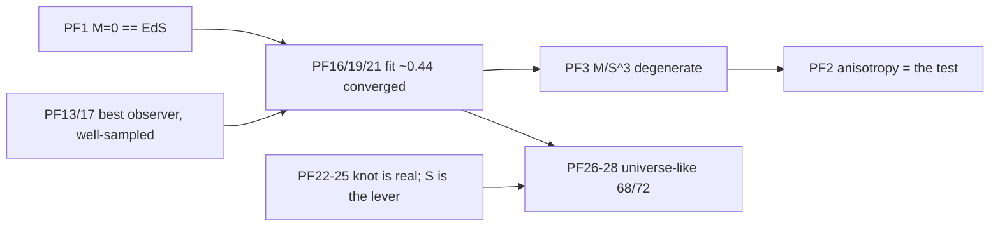

# Findings — current verdicts + PF index

The load-bearing research conclusions. Code comments cite them by ID (`PF23`, `PF26`, ...);
IDs are stable, never renumber. Detail + evidence: [fit.md](./fit.md) (Pantheon fit),
[structure.md](./structure.md) (anisotropy, knot, universe-fit), [methodology.md](./methodology.md)
(how to measure honestly). Open work: [../plans/roadmap.md](../plans/roadmap.md).

## Headline (what the paper may claim)

- **Fit**: from-sim μ(z) vs Pantheon+ reaches best-observer χ²/dof ≈ 0.44 (ΛCDM 0.436,
  EdS null 0.843), for MANY configs, converged 10k→100k particles and in dt. MATCHES ΛCDM,
  does not robustly beat it; isotropic fit is degenerate in M/S³.
- **Structure**: honest meta-structure = periodic virialized MEDIUM (2K/|U|≈1). With the
  joint fit+knot S selection, **68/72** (centerM × seed) cells are universe-like at 8k
  particles (69/72 at 2k). Heavy progenitor (centerM≈M_value) is the robust regime.
- **Discriminating signal**: anisotropy (shear, Hubble dipole, bulk flow), not the
  isotropic Hubble diagram.



## Do NOT claim

- "Beats ΛCDM" — sub-ΛCDM counts move with N/observer sampling (PF28).
- Any best-observer χ² from small `observer_k` (≪0.43 = tracer noise, PF17).
- Best-observer ranks compared across particle counts at the 3rd decimal (±0.005–0.01, PF26/28).
- "Heavier progenitor cures the knot" as a clean trend — seed dominates at mid centerM;
  node spacing S is the direct lever (PF25).
- A force-balanced lattice as "virialized" (PF8/PF21).
- The paper's legacy R²_size/R²_rate table (M=9000/S=38 …) as current-physics evidence: it
  predates the EdS-consistent ICs ([../paper-reference.md](../paper-reference.md)).

## PF index

| ID | Claim (current) | File |
|----|-----------------|------|
| PF1 | M=0 reproduces EdS by construction (~0.2% growth, 0.02 mag); every knot must keep it | fit |
| PF2 | Vacuum node rearrangement is traceless: shear/dipole move ~10x, isotropic fit doesn't | structure |
| PF3 | Isotropic fit flat in M once S co-fit (M/S³ ridge); report bands, not a best M | fit |
| PF4 | (legacy) cube26 uniform band ~0.52 at 400p; superseded by PF16/PF21 | fit |
| PF5 | Runaway boundary real, S_crit ∝ M^(1/3); growth anchor rejects it | fit |
| PF6 | Outer mass (WS4 centerM) barely moves the isotropic fit | fit |
| PF7 | Geometries differ by node PLACEMENT (1/r³ near field), not perturbation machinery | methodology |
| PF8 | Force balance is the wrong "virialized" test; lattice ~1e-29 was a central-mass artifact | methodology |
| PF9 | Slingshot = near-point node close pass; node softening / bounded law tame it | methodology |
| PF10 | start_size_scale changes the a(t) SHAPE at M>0 (not an offset) | fit |
| PF11 | Figure and CSV χ² share one param builder; quote the CSV | methodology |
| PF12 | GRF not broken: swing = cube-vs-sphere setup bug (fixed) + real clustering | fit |
| PF13 | We are a random observer: report best observer (existence) + fraction viable | methodology |
| PF14 | `vir_extent_couples_nodes`: N ∝ extent³ keeps ball density | [../physics/node-geometry.md](../physics/node-geometry.md) |
| PF15 | (legacy lattice) wide node-mass σ avoids small-S cloud collapse | fit |
| PF16 | Production resolution: ≈ΛCDM best-observer, many configs, step-converged | fit |
| PF17 | Small-k local observers are noise; best << median = fluke | methodology |
| PF18 | Whole cloud drifts ~30 Gpc coherently (dark-flow-like); unobservable from inside | structure |
| PF19 | Hero ladder 10k→100k: best-observer 0.442–0.449, converged | fit |
| PF20 | Wide σ + segregation parks mass on inert far nodes; prefer σ≲1 | structure |
| PF21 | Medium (periodic, virial) is the honest structure; fits ~0.44 at σ=1 | fit |
| PF22 | Barnes-Hut adds no artifact; the central knot collapse is real physics | structure |
| PF23 | Medium fit seed-robust ~0.44; knot N-converged; grfmass weakens it | structure |
| PF24 | centerM = progenitor mass in both epochs; outer mass inert; vcm is a structure lever | fit |
| PF25 | 72-cell centerM campaign: fit flat; knot mediated by S; cm=M_value robust | structure |
| PF26 | Universe-fit composite ranking; χ²-alone anti-selects structure; margin rule | structure |
| PF27 | Knot-guarded re-sweep: 69/72 qualify, χ² cost < 0.005 | structure |
| PF28 | 8k re-run: 68/72, verdict N-stable; low-centerM knot sharpens with N | structure |
| PF-OBSCACHE | Observer params must key the metrics cache (fixed) | methodology |

```bash
grep -rn "PF26" --include=*.py --include=*.json .   # code/configs that rely on a finding
```
