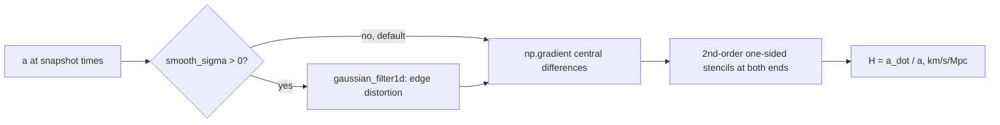

# Expansion rate H(t) from a sampled a(t)

`cosmo/analysis.py::calculate_hubble_parameters(t_Gyr, a, smooth_sigma=0.0)` differentiates the
N-body scale factor for the size/rate plots and the legacy `objective="lcdm"` metrics. The
Pantheon path never differentiates a(t) — it integrates dt/a
([../physics/hubble-diagram.md](../physics/hubble-diagram.md)). ΛCDM H comes from the analytic
Friedmann solution ([lcdm-baseline.md](./lcdm-baseline.md)).



## Algorithm
- Interior: `np.gradient(a, t_s) / a` (central differences, O(h²)).
- Edges replaced by second-order one-sided stencils:
  H[0] = (−3a₀ + 4a₁ − a₂)/(2Δt·a₀), H[−1] = (3aₙ − 4aₙ₋₁ + aₙ₋₂)/(2Δt·aₙ).
- Converted to km/s/Mpc.

## Lesson: never smooth before differentiating
Gaussian smoothing (σ=2) before the derivative produced ~80% errors at both ends (3.8 Gyr:
178 → 37 km/s/Mpc; 13.8 Gyr: 72 → 16), because `mode='reflect'` flattens the boundary slope.
Raw derivatives were within 0.2–4% at the edges. Hence `smooth_sigma = 0` (default); use
σ = 1–2 only for very noisy, very short series, and never for edge values.

```python
from cosmo.analysis import calculate_hubble_parameters
H_kms_Mpc = calculate_hubble_parameters(t_Gyr, a, smooth_sigma=0.0)   # same length as a
```

Tests: `tests/test_hubble_parameter.py` (edge stencils on t², ΛCDM consistency ≤ 2%,
no jumps > 15%, matter-only monotone decrease, H(13.8) ≈ 70).
