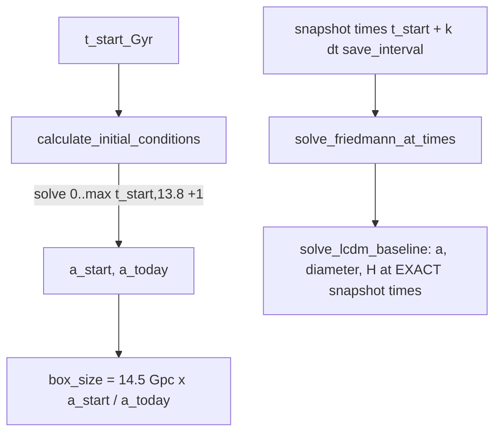

# ΛCDM baseline and initial box size

Every ΛCDM reference is ANALYTIC (Friedmann ODE, Ω_m 0.3, Ω_Λ 0.7, H0 70), never an N-body
ΛCDM run: leapfrog/RMS noise does not belong in a reference curve. Used by the size/rate
comparison plots and the legacy `objective="lcdm"` sweep; the Pantheon path uses analytic
distance moduli ([../physics/hubble-diagram.md](../physics/hubble-diagram.md)).



## Contracts (cosmo/analysis.py, cosmo/factories.py)
- `solve_friedmann_at_times(t_array_Gyr)` evaluates at exactly the N-body snapshot times, so
  relative expansion starts at 1.0 to ODE tolerance (~1e-7; an interpolated 400-point grid
  used to start at ~0.998 and fake a "bump").
- `calculate_initial_conditions(t_start)` must solve to ≥ 13.8 Gyr to get a_today (an old bug
  solved only to t_start). box_size is the DIAMETER (RMS radius = box/2); 14.5 Gpc today.
  t_start 2.9 → a ≈ 0.310, box ≈ 4.39 Gpc; 5.8 → a ≈ 0.503.
- `factories.setup_simulation_context(t_start, t_duration, n_steps, save_interval)` returns
  (box_size_Gpc, a_start, baseline) — the one entry point used by `run_simulation.py`,
  `sweep.py` and the figure scripts.
- `expected_growth_factor(t_start)` (cosmo/parameter_sweep.py) = ΛCDM a(13.8)/a(t_start) is
  the growth anchor (≈3.30 at 2.9 Gyr).

```python
from cosmo.factories import setup_simulation_context
box_Gpc, a_start, base = setup_simulation_context(2.9, 10.9, n_steps=546, save_interval=10)
base["t"][0] == 0.0 and np.isclose(base["a"][0], a_start, rtol=1e-6)   # box_Gpc ≈ 4.388
```

Tests: `tests/test_simulation_baseline.py`, `tests/test_friedmann_at_times.py`,
`tests/test_factories.py`.
