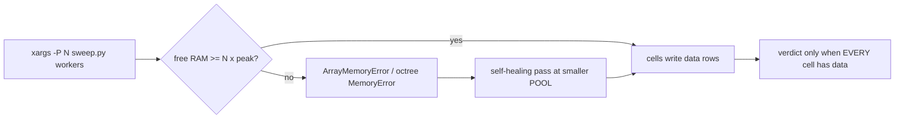

# Memory budget & sweep parallelism

Back to [lode-map](../lode-map.md). Related: [integration](../physics/integration.md),
[sweep](../scripts/sweep.md).



## The binding constraint on a parallel sweep is RAM, not cores

Sweep cells are independent single-threaded `python sweep.py --config` processes, so
throughput scales with how many run at once — until they collectively exhaust free RAM
and die with `numpy._core._exceptions._ArrayMemoryError`. Size a pool against PEAK
transient memory per sim, never steady-state working set (a 24k-particle cell sits at
~270 MB but SPIKES far higher).

## `Integrator.potential_energy` is budgeted by bytes

PE is a diagnostic (energy-conservation history, sampled ~10x/run at N<=20000, ~5x
above — see `evolve`). It is chunked to avoid the full (N,N,3) array, but the block
heuristic counted ELEMENTS only:

```python
block = max(1, int(1e7 // N))        # OLD -- under-counted ~9x
```

Each iteration actually allocates `diff` (b,N,3) **plus ~6 (b,N) arrays** (`r2`,
`r_soft`, `mp`, `pe`, `mask`, and the `pe[mask]` copy) => `b*N*8*(3+6)` bytes. The
heuristic ignored both the xyz factor and the temporaries, so at N=24000 it picked
b=416 => **~719 MB per PE call**.

FIX (`cosmo/integrator.py`): budget PEAK BYTES via the module constant
`_PE_BLOCK_BYTES = 64 MB`:

```python
block = max(1, int(_PE_BLOCK_BYTES // (max(1, N) * 8 * 9)))
```

| N | block old -> new | peak per PE call |
|---|---|---|
| 2 000 | 5000 -> 466 | 720 MB -> 67 MB |
| 8 000 | 1250 -> 116 | 720 MB -> 67 MB |
| 24 000 | 416 -> 38 | 719 MB -> **66 MB** |
| 100 000 | 100 -> 9 | 720 MB -> 65 MB |

Peak is now ~flat in N. **The PE VALUE is unchanged** — same pairs, same
upper-triangle mask, only block boundaries move (verified vs a dense reference:
rel diff 1.2e-16). Pure memory fix, no physics change, no cache-key change.

## The PE fix was necessary but NOT sufficient on a RAM-starved box

`_PE_BLOCK_BYTES` removed the 719 MB PE spikes, but the cmx3 campaign still OOMed
~6 heavy cells (centerM 300/1000/3000 = 24000 particles) at POOL=4 — this time in
`barnes_hut_numba.build_octree` (`MemoryError: Allocation failed`). The octree
itself is only ~25 MB (`max_nodes = N*10` = 240k nodes at 24k particles), so the
allocation is not intrinsically large: it fails because the SYSTEM is out of RAM at
that instant. This machine has 32 GB but ~26 GB is held by other apps => only
~6 GB free, and **measured per-sim working set is ~1.3–1.4 GB for a 24k-particle
cell, growing over the run** (accumulated snapshots). 4 concurrent heavy cells
(~5 GB peak) against ~6 GB free intermittently tips over.

CONCLUSION: on THIS box, POOL=3 (~4 GB peak, headroom under ~6 GB free) is the safe
ceiling for the 24k-particle tier; POOL=2 for retries. Closing other apps (freeing
RAM) or the new 20-core/higher-RAM box would lift this — the constraint is free RAM,
full stop. This is NOT a code bug; nothing is lost (failed cells are retryable).

## Pool driver rules (learned the hard way on the cmx3 campaign)

- **Never a `wait`-barrier batch.** The original `cmx3_driver.sh` launched 4 then
  `wait`ed for ALL, so 3 slots idled behind each batch's slowest cell — measured 1 sim
  running at ~8% CPU on 8 logical threads.
- **Do not hand-roll a pool with `wait -n`.** It returns immediately for already-reaped
  jobs, so a `while`-spin inflates the counter (140 phantom "completions" for 72
  configs). Use `xargs -P N`.
- **A cell that writes no data row is a FAILURE, not a completion.** Log real OK/FAIL,
  delete the header-only stub CSV so a rerun recomputes it, and **refuse to write the
  verdict / done-marker unless every cell has data** — otherwise a partially-crashed
  run masquerades as a finished campaign.
- **Beware self-matching kills.** `kill` loops that match a process cmdline against a
  substring (e.g. `cmx3_pool`) also match the *agent's own shell*, which runs that
  string in its command line. Match the exact script path and exclude `$$`/`$PPID`.

Current cmx3 driver: `results/logs/cmx3_pool_driver.sh` (gitignored) — SELF-HEALING
xargs pool: default POOL=3 pass 1, RETRY_POOL=2 for up to MAX_PASSES=5 passes,
recomputing any cell that lacks a data row each pass; resumable; OK/FAIL logging;
writes the verdict + `cmx3_done.txt` ONLY when all 72 cells have data, else logs
`INCOMPLETE` with the still-failing cells. Relaunch idempotently:
`nohup bash results/logs/cmx3_pool_driver.sh 3 2 5 &`.
