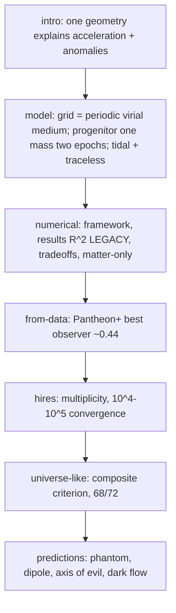

# Paper reference — docs/VirializedMetaStructure.tex

"Replacing Dark Energy and Unifying Large-Scale Anomalies: The Progenitor Node Model within a
Virialized Meta-Structure" — working draft (not published) by Martin, independent researcher.
The paper defines INTENT; the code is the implementation; the findings are the evidence
([findings/summary.md](./findings/summary.md)). "Progenitor Node Model" = External-Node Model
(tidal mechanism) + Progenitor Hypothesis (initial conditions). Theory digest:
[physics/theoretical-framework.md](./physics/theoretical-framework.md).



## Section map (labels) and status vs current evidence
| label | content | status |
|---|---|---|
| sec:grid | "virialized" = virial equilibrium, periodic medium; lattice only as analytic idealization | current (PF21) |
| sec:progenitor | M_prog one parameter in both epochs; distinguished M_prog = M_ext | current (PF24) |
| sec:tidal / sec:traceless / sec:estimation | a_tid ≈ 2GMR/S³, traceless tides, S ≈ 39 Gpc for 5e55 kg | current |
| sec:framework / sec:results / sec:tradeoffs / sec:matter-only | R²_size / R²_rate vs ΛCDM for M9000/S38, M875/S24, M92/S15 (cube26, 2000p, t 5.8→13.8) | **LEGACY**: produced by the calibrated-velocity ICs before 2026-06-24 (EdS-consistent ICs); not re-validated; the abstract still cites them |
| sec:from-data | best-observer χ²/dof ≈ 0.44 vs ΛCDM 0.437, EdS 0.844; conservative uniform-node centre baseline 0.501 | current (PF16/PF19) |
| sec:hires | fig 5–7 multiplicity + 10^4–10^5 ladder (lattice, wide σ) | current (PF19) |
| sec:universe-like | composite criterion, χ²-alone anti-selects, 69/72 → 68/72 at 8k, fig 8–9 | current (PF25–PF28) |
| sec:scope = sec:limitations | late-time, Newtonian; no CMB/BAO/structure/GR | current |
| sec:predictions (phantom, dipole, axis-of-evil, dark-flow) | numbers from `compute_predictions.py` on the legacy M9000/S38 lattice; axis-of-evil argued from cubic lattice symmetry | needs re-derivation for the medium |
| sec:defenses / sec:metabolism | dark-giant principle; speculative Great Metabolism | qualitative |

## Figures
`docs/fig_meta_structure.png`, `fig1-3_4f97dec` (legacy R² plots), `fig4_pantheon`,
`fig5-7_hero_*_66fb244`, `fig8_centerm_knot`, `fig9_universe_candidates` — sources in
[scripts/visualization.md](./scripts/visualization.md). Colour convention (matches
`hubble_diagram.py`): ΛCDM blue, External-Node red dashed / orange (best observer), matter-only
or EdS green.

## Writing conventions
- Numbers quoted in the paper come from the sweep CSVs (authoritative), with the ΛCDM and EdS
  references alongside; claims avoid "beats ΛCDM".
- LaTeX: `\label`/`\ref` + hyperref; tables in `table` floats; R² always `$R^2$`; ``...'' quotes.
- Paper edits are Martin's decision; propose, don't silently rewrite claims.

```bash
grep -n '\\label{sec:' docs/VirializedMetaStructure.tex    # section map
```
