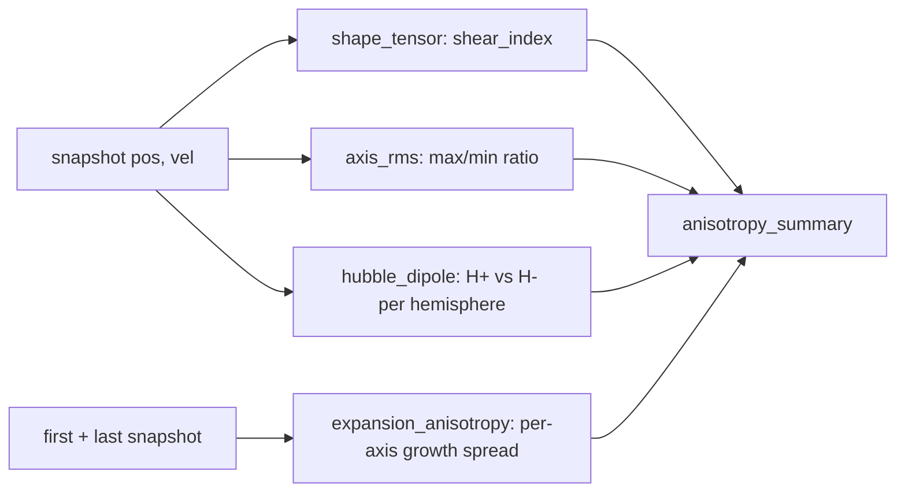

# Anisotropy diagnostic — shear and Hubble dipole

The model's discriminating observable (PF2, [../findings/structure.md](../findings/structure.md)):
node asymmetries leave the isotropic Hubble diagram almost untouched but imprint shear, a
Hubble dipole and bulk flow. `cosmo/anisotropy.py` (pure, deterministic, SI arrays) +
`anisotropy_report.py` (CLI table).



## Quantities (0 or 1 = isotropic)
| Function | Output | Isotropic |
|---|---|---|
| `shape_tensor` | S_ij = mean(x_i x_j); `shear_index` = (λmax − λmin)/mean λ | 0 |
| `axis_rms` | per-axis RMS; `max_min_ratio` | 1 |
| `hubble_dipole` | H± from a v·r̂-vs-r fit per hemisphere; dipole = (H+ − H−)/H_mean; `best_axis` | 0 |
| `expansion_anisotropy` | rms_final/rms_initial per axis; `spread` | 1 |

## Contracts
- COM position AND velocity re-subtracted before fitting.
- **Starved hemisphere ⇒ `degenerate=True`**, never a confident `dipole=0` (substituting the
  global H would fake isotropy); best-axis search skips starved axes. N < 2 (N < 4 for the
  dipole), all-zero or collinear input ⇒ degenerate dict.
- Anisotropy is noisy at low N (`anisotropy_report.py` warns below 2000); converging it at high N
  is open work ([../plans/roadmap.md](../plans/roadmap.md)).
- A future real-galaxy-catalog init would imprint survey-mask anisotropy: keep such runs off
  this diagnostic or flag them.

```python
from cosmo.anisotropy import anisotropy_summary
s = anisotropy_summary(pos_final, vel_final, positions_initial=pos_initial)
s["shape"]["shear_index"], s["hubble_dipole"]["dipole"], s["hubble_dipole"]["degenerate"]
s["axis_rms"], s["expansion"]   # expansion is None without positions_initial
```

Tests: `tests/test_anisotropy.py` (incl. the starved-hemisphere regression).
