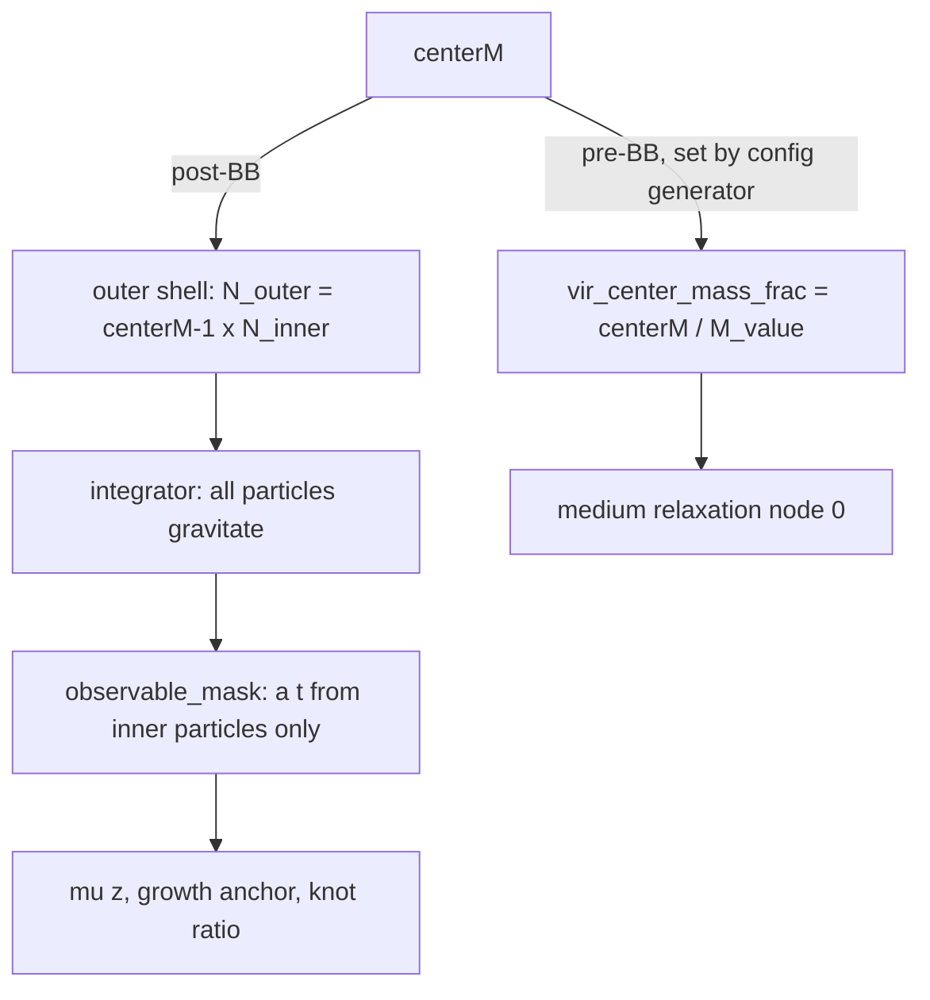

# centerM — the progenitor's mass, in both epochs

Settled by Martin (2026-07-13, not a fork to re-open): the progenitor was a TYPICAL node of the
virialized meta-structure with mass centerM (in observable-universe masses); the Big Bang split
it into the particle cloud. One number, two epochs:
- **post-BB**: total simulated matter = centerM × observable (outer particles beyond the
  observable sphere);
- **pre-BB**: the medium's "us" node mass, `vir_center_mass_frac = centerM / M_value`
  (mean-HMEA units). centerM = M_value ⇒ the progenitor is literally a typical node.
Fit/structure evidence: [../findings/fit.md](../findings/fit.md) (PF6, PF24),
[../findings/structure.md](../findings/structure.md) (PF25–PF28).



## Post-BB: the outer shell (`center_node_mass`, cosmo/particles.py)
- centerM ≥ 1 (clipped). 1.0 ⇒ no outer particles, byte-identical to the plain cloud.
- centerM > 1: N_outer = round((centerM − 1) · N_inner · outer_density_ceiling) particles
  uniformly in the shell R_obs < r ≤ R_obs·centerM^{1/3}, same per-particle mass, drawn AFTER
  the inner particles (inner draws untouched). Requires `eds_consistent=True`; composes with
  every inner sampler (the shell itself is always uniform).
- `outer_density_ceiling` (default 1, capped at 2.0 with a warning) raises only the outer density.
- `outer_particle_cap` > 0 (production 2.0): caps N_outer at cap·N_inner with proportionally
  HEAVIER outer particles, outer total mass exact (shell theorem; makes centerM ~3000 feasible).
- Softening stays frozen at the 1 Gpc base: centerM changes a(t) only through real gravity.

## The observable mask (the hard invariant)
`ParticleSystem.observable_mask` is True for inner indices 0..N_inner−1.
`CosmologicalSimulation._calculate_expansion_history` measures RMS size (and COM) on the
masked subset only, so a(t), μ(z), the growth anchor and the knot ratio see only the
observable cloud; outer particles still exert gravity. At centerM = 1 the mask is all-True.

## Pre-BB coupling
`SimulationParameters` keeps `center_node_mass` and `vir_center_mass_frac` INDEPENDENT; the
two-epoch identity is imposed by the campaign generator (`sweeps/_gen_centerm_campaign.py`:
`cfg["vir_center_mass_frac"] = cM / M_VALUE`). Any new centerM config must set both.
Structural effect of vcm (single seed): near-massless us sits among nodes (nearest 0.70 S);
peer-mass us (vcm = 1) carves the emptiest neighbourhood (1.54 S); heavy us gathers satellites.

## How to sweep it (user rules)
- Sweep centerM LARGE and log-spaced (1…3000, 8+ values) × seeds; a handful ≤ 3 is not a sweep.
- The goal is STRUCTURE (knot-free, universe-like cloud), not the isotropic fit (outer mass is
  inert, PF6). Tidal stretching of the cloud is the sought effect, not a failure; the growth
  anchor decides.
- Gate: no HMEA within ~15 Gpc (we would have seen it). Nodes near S are fine.
- Off-by-one caveat in the verbatim definition ("centerM=1 ⇒ observable is half the node")
  vs code (total = centerM × observable): negligible at large centerM; ask before relying on
  centerM ≈ 1 semantics.

```python
from cosmo.constants import SimulationParameters
M = 3000; cM = 1000.0
p = SimulationParameters(M_value=M, S_value=79, center_node_mass=cM, outer_particle_cap=2.0,
                         node_geometry="virialized", vir_relax_mode="medium",
                         vir_mass_spread=0.5, vir_n_nodes=300, vir_center_mass_frac=cM / M)
```

Tests: `tests/test_observable_mask.py`, `tests/test_ws4_cache_slug.py`,
`tests/test_virialized_medium.py::test_centerM_is_taken_into_account`.
