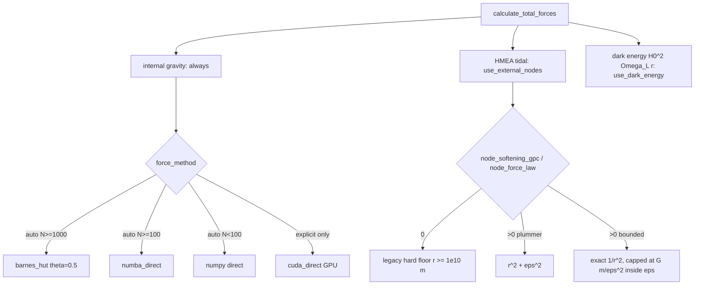

# Forces — internal gravity, HMEA tides, dark energy

`Integrator.calculate_total_forces` (cosmo/integrator.py) sums three accelerations; the
integrator that consumes them: [integration.md](./integration.md). Node layouts:
[node-geometry.md](./node-geometry.md). Why softening/bounded laws exist (slingshot, PF9):
[../findings/methodology.md](../findings/methodology.md).



| Mode (CosmologicalSimulation flags) | internal | tidal | dark energy |
|---|---|---|---|
| External-Node (`use_external_nodes=True`) | ✓ | ✓ | – |
| Matter-only / EdS (both False) | ✓ | – | – |
| N-body ΛCDM (`use_dark_energy=True`) | ✓ | – | ✓ |
Hubble drag exists (`apply_hubble_drag`, matter-only exp(−0.2·H·dt) velocity damping) but is
hard-disabled (`use_hubble_drag=False` in `CosmologicalSimulation`). The Pantheon comparison
uses ANALYTIC ΛCDM, never an N-body ΛCDM run.

## Internal gravity
a_i = Σ_j G m_j (r_j − r_i)/(|r_ij|² + ε²)^{3/2}; ε uses the softened distance for both
magnitude and direction.
- **Softening**: ε = 1 Gpc × (mean particle mass / M_obs)^{1/3}, times sqrt(100/N) clamped to
  [1, 5] when N < 100. The 1 Gpc base is frozen (independent of centerM).
- **Methods** (`force_method`, validated in SimulationParameters, cache slug only if ≠ auto):
  `direct` (numpy, O(N²) memory), `numba_direct` (JIT O(N²), exact), `barnes_hut` (numba
  octree, θ=0.5, max_depth 60, node budget 10·N), `cuda_direct` (numba.cuda direct sum, one
  thread per particle; equals numba_direct to ~1e-9 under the CUDA simulator; raises if no
  CUDA backend). `auto` never selects the GPU.
- Barnes-Hut force error vs exact direct: < 5% (norm over all particles) at θ = 0.5, shrinking
  monotonically with θ (`tests/test_barnes_hut.py`); aggregate observables are far tighter —
  artifact-free at chart scale (PF22). Reproduce any chart with `numba_direct`.

## HMEA tidal force
a_tid(r) = Σ_nodes G m_k (r_k − r)/|r_k − r|³ over the grid built by `HMEAGrid`
(cosmo/particles.py). Kernel `cosmo/tidal_forces_numba.calculate_tidal_forces_numba`;
`HMEAGrid.calculate_tidal_acceleration_batch(use_numba=False)` is a numpy mirror, branch for
branch. Law codes `NODE_FORCE_LAW_CODES = {"plummer": 0, "bounded": 1}` (constants.py; keep
kernel, fallback and constants in lock-step).
- `node_softening_gpc = 0` (default): legacy hard floor |r| ≥ 1e10 m ≈ no softening.
- `> 0`, `plummer`: r² → r² + ε²; caps the close-pass kick (far field changes < 5% at 1 Gpc).
- `> 0`, `bounded`: exact Newtonian outside ε; inside, magnitude capped at G m/ε² (bodies still
  attract at full strength, cannot be flung across the node). Equals `plummer` at ε = 0.
- Production medium runs use `node_softening_gpc = 1.0`, `plummer`.
- All vanish at M_ext = 0 (zero node mass ⇒ zero tide), preserving PF1.

## Per-node perturbation knobs (non-medium geometries)
`ExternalNodeParameters.node_masses(n)` and `node_scale_factors(n)`: mean-preserving
log-normals, `w = exp(amp·g)/mean`, g from `default_rng(node_mass_seed)`.
- `node_mass_amplitude`: mean node mass stays M_ext_kg exactly (total mass, Ω_Λ,eff fixed);
  ignored by the virialized geometry (its own mass rule owns masses).
- `node_s_amplitude`: scales each node's distance along its own ray, mean factor 1.
- **Both take the SAME first n normals** (fresh generator, same seed), so with both amplitudes
  > 0 heavier nodes are also farther: perfectly rank-correlated, not independent. No config uses
  `node_s_amplitude > 0`; decoupling would change physics (needs a key slug). Open decision in
  [../plans/roadmap.md](../plans/roadmap.md).

## Dark energy (N-body ΛCDM only)
a_Λ = H0² Ω_Λ r (proper coordinates, outward). No drag term: in proper coordinates −2Hv
over-damps (with v≈Hr it is ~3× the Λ push).

## Order-of-magnitude label
Ω_Λ,eff = G M_ext/(S³ H0²) (`ExternalNodeParameters.Omega_Lambda_eff`). It only labels a
config; the sim uses the full node sum, and the semi-analytic curve built from it is circular
([hubble-diagram.md](./hubble-diagram.md)).

```python
from cosmo.constants import SimulationParameters
p = SimulationParameters(M_value=3000, S_value=89, node_geometry="virialized",
                         vir_relax_mode="medium", node_softening_gpc=1.0,
                         force_method="numba_direct")   # exact internal gravity, no tree
p.external_params.node_softening_m, p.external_params.node_force_law_code  # 3.0857e25, 0
```

Tests: `tests/test_forces.py`, `tests/test_tidal_numba.py`, `tests/test_barnes_hut.py`,
`tests/test_slingshot.py`, `tests/test_cuda_direct.py`, `tests/test_node_masses.py`,
`tests/test_node_s_amplitude.py`.
