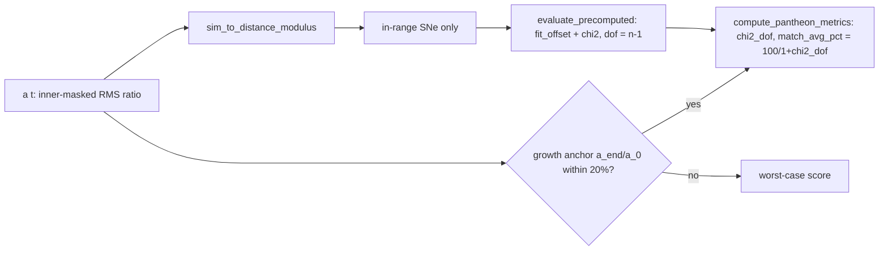

# Hubble diagram — from-sim μ(z) vs Pantheon+

The model's observable test: turn the N-body a(t) into a distance-modulus curve and score it
against real Pantheon+SH0ES supernovae. Numbers: [../findings/fit.md](../findings/fit.md).
Per-particle vantages: [observers.md](./observers.md).



## a(t) → μ(z): `cosmo/sim_distance.py::sim_to_distance_modulus`
1. t_abs = t_start + t (sim times are relative); the last snapshot must be within 0.2 Gyr of
   13.8 Gyr, so runs use `t_duration = 13.8 − t_start` (ValueError otherwise).
2. Renormalize a to 1 today; z_snap = 1/a − 1.
3. D_C(t_i) = c ∫_{t_i}^{today} dt/a by cumulative trapezoid — **no differentiation of a(t)**
   (avoids the edge artifacts of [../numerics/expansion-rate-calculation.md](../numerics/expansion-rate-calculation.md)).
4. d_L = (1+z) D_C (flat), μ = 5 log10(d_L/Mpc) + 25; interpolate onto SN redshifts, HARD-CLIP
   to the covered z range (no extrapolation); returns an `in_range` mask.
H0 never enters: the absolute scale sits in the marginalized offset; only the SHAPE matters.
Feeding analytic ΛCDM a(t) reproduces `model_distance_modulus(z,"lcdm")` to < 0.03 mag.

## χ² engine: `cosmo/hubble_diagram.py`
- `fit_offset`: closed-form inverse-variance mean of μ_obs − μ_model (absorbs M_B + H0).
- `evaluate_precomputed(z, mu_obs, sigma, mu_model)` → chi2, dof = n−1, chi2_dof, R2,
  residuals. `evaluate_model` does the same for analytic models.
- Diagonal errors only (`MU_SH0ES_ERR_DIAG`); full STAT+SYS covariance is open work.

## Data: `cosmo/pantheon.py::load_pantheon`
Reads `data/pantheon_plus/Pantheon+SH0ES.dat` by column name (zHD, MU_SH0ES,
MU_SH0ES_ERR_DIAG, IS_CALIBRATOR); z ≥ 0.01, Cepheid calibrators excluded, sorted by z. The
file is not committed (README in that folder); tests use `tests/fixtures/pantheon_synthetic.dat`.

## The growth anchor (why a bare shape fit is not enough)
Renormalizing a=1 today lets a runaway config (e.g. 25000× expansion) fit the z-window with a
nonsensical history. `compute_pantheon_metrics` therefore rejects any a(t) whose
a[−1]/a[0] differs from `expected_growth_factor(t_start)` (ΛCDM a(today)/a(t_start), ≈3.30 at
2.9 Gyr) by more than `GROWTH_ANCHOR_TOL = 0.20`. Rejected rows keep `growth_factor` /
`growth_target` for transparency. It checks TOTAL growth only, not the a(t) shape (PF20 gap).

## References (analytic, per run)
`sweep._compute_reference_chi2` scores analytic ΛCDM (0.436) and the Einstein–de Sitter
Ω_m=1 null (0.843) with the same engine, over ALL loaded SNe. The model is scored on its own
in-range subset (`n_sne_used`); SNe above the model's z coverage (growth ≈3 ⇒ z_max ≈2) are a
handful at z>2, so the comparison is near- but not exactly same-set.

## Scripts
- `hubble_diagram_nbody.py` — one from-sim config (default t_start=2.9, 2000p, 273 steps):
  μ(z) + Δμ-vs-ΛCDM panel + EdS null, JSON sidecar `<png>.summary.json`,
  `--from-best-config <sweep_csv>`; all knobs go through `cosmo.cli.args_to_sim_params`.
- `hubble_diagram.py` — SEMI-ANALYTIC: plugs Ω_Λ,eff = GM/(S³H0²) into the ΛCDM E(z). At
  Ω_Λ,eff = 0.70 it IS ΛCDM (circular); illustration only, never evidence.

## Known unit wrinkle
`sim_distance` converts Gyr with `CosmologicalConstants.Gyr_to_s` (365-day year) while
snapshot times use 365.25-day years: D_C is scaled by a constant 0.9993 ⇒ a 0.0015 mag μ offset,
fully absorbed by `fit_offset` (no χ² effect). See [../practices/unit-conventions.md](../practices/unit-conventions.md).

```python
from cosmo.sim_distance import sim_to_distance_modulus
from cosmo.hubble_diagram import evaluate_precomputed
d = sim_to_distance_modulus(pan["z"], a_curve, t_Gyr, t_start_Gyr=2.9)
m = d["in_range"]
ev = evaluate_precomputed(pan["z"][m], pan["mu"][m], pan["sigma"][m], d["mu"])
ev["chi2_dof"]
```

Tests: `tests/test_sim_distance.py`, `tests/test_hubble_diagram*.py`,
`tests/test_parameter_sweep_pantheon.py`, `tests/test_pantheon.py`.
