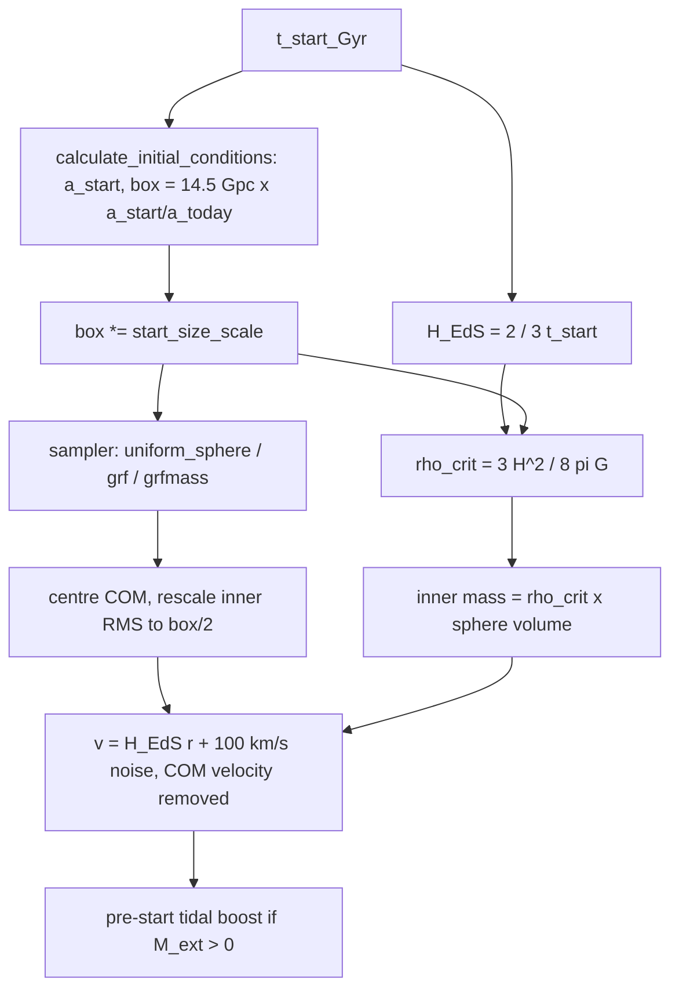

# Initial conditions — EdS-consistent cloud, samplers, pre-start boost

`ParticleSystem` (cosmo/particles.py) builds the cloud; `CosmologicalSimulation.__init__`
(cosmo/simulation.py) wires the flags and applies the boost. The invariant these protect
(PF1): [../findings/fit.md](../findings/fit.md). Outer mass beyond the observable sphere:
[centerm-outer-mass.md](./centerm-outer-mass.md).



## EdS-consistent ICs (default `eds_consistent=True`, dark energy off)
- Hubble flow v = H_EdS·r with H_EdS = 2/(3 t_start) (absolute age, NOT Ω_m=0.3 H(a)).
- Cloud mass = ρ_crit(H_EdS) × (4/3)π R³ with R = (box/2)/√(3/5) (uniform ball: RMS = R√(3/5)).
  At t_start 2.9 Gyr that is ≈8.65e53 kg ≈ 8.6 M_obs.
- Together they make M_ext=0 reproduce EdS (PF1) with NO velocity calibration.
- `t_start ≤ 0` has no finite H_EdS ⇒ silently falls back to the legacy path.
- Peculiar velocities: Gaussian σ = 100 km/s per component; COM velocity removed.
- The inner RMS is renormalized to exactly box/2 after COM centring, so every model starts at
  the identical size (random sampling would otherwise leave ~0.1–1% scatter).

## Samplers (`init_distribution`, `init_kwargs`)
| value | positions | masses |
|---|---|---|
| `uniform_sphere` (default) | rejection-sampled ball (legacy loop, seeded by `np.random.seed(seed)`) | `mass_randomize` ∈ [0,1]: uniform in mean·[1−r, 1+r], renormalized (SimulationParameters default 0.5; sweep default 0.0) |
| `grf` | BBKS ΛCDM P(k) field + Zel'dovich displacement of an Ng³ grid (`sample_grf`) | as above |
| `grfmass` | UNDISPLACED jittered grid (quasi-uniform) | weights max(1+δ, 0.05), δ rms 0.5, rescaled to the EdS total (`sample_grf_mass`); `mass_randomize` must be 0 |
- `support="sphere"` (default for grf/grfmass): Lagrangian grid masked to the uniform_sphere
  radius, so the only difference vs uniform is clustering. `"box"` is the legacy cube with a fat
  radial tail — comparison only (PF12). Sweep key `grf_support`; `sphsup` cache slug.
- GRF seeds derive from the global `np.random` stream (`randint`) ⇒ reproducible per `seed`.
- Mass-preserving for every sampler: total == EdS mass ⇒ PF1 holds for grf and grfmass.

## start_size_scale (default 1.0)
`box_size_Gpc *= start_size_scale` before particles are built; the EdS mass scales with
volume so density (and PF1) is unchanged, but at M>0 the cloud spans a different fraction of
the fixed S ⇒ different a(t) shape (PF10). ≤ 0 raises. Slug `{x}ssz` when ≠ 1.

## Pre-start tidal boost (`pre_start_tidal_boost=True`)
The nodes pulled on the cloud from the Big Bang to t_start, so it should arrive faster than
pure EdS flow. Linear early-time derivation (g_r ∝ a(t), EdS a ∝ t^{2/3}, t_i → 0):
dv_r = g_r(t_start) · (3/5) · t_start along r̂, with g_r the same node sum the integrator uses;
COM velocity removed after. Active only with external nodes AND eds_consistent AND t_start > 0.
Vanishes at M=0 (boost ON == OFF byte-identical there). Effect on growth is small (+0.35% at
M3000/S30 cube26) but it can tip near-runaway cells over. Not a fit knob.

## Why not simply start earlier
The M=0 control drifts off EdS at early starts (g/EdS 1.001 @2.9, 1.005 @2.0, 1.028 @1.0 Gyr),
dt-independent ⇒ a discreteness floor (finite N, softening, peculiar noise). t_start = 2.9 Gyr
(z ≈ 2.2, full Pantheon+ coverage) is the standard; the boost supplies the earlier history.

## Legacy calibrated-velocity path (off by default)
`_calibrate_velocity_for_lcdm_match` rescales velocities so matter-only tracks ΛCDM (with a
tiny 1 M_obs cloud). It made M=0 track ΛCDM instead of EdS — the old core bug. Runs only when
`eds_consistent=False` or an explicit `damping` is passed; its cache key carries
start-size/softening/geometry slugs. Results produced before 2026-06-24 used this path,
including the paper's R² table (see [../paper-reference.md](../paper-reference.md)).

```python
from cosmo.constants import SimulationParameters
from cosmo.factories import setup_simulation_context, run_external_node_simulation
box, a_start, _ = setup_simulation_context(t_start_Gyr=2.9, t_duration_Gyr=10.9, n_steps=546)
p = SimulationParameters(M_value=3000, S_value=89, n_particles=2000, t_start_Gyr=2.9,
                         t_duration_Gyr=10.9, n_steps=546, init_distribution="grfmass",
                         init_kwargs={"support": "sphere"}, mass_randomize=0.0)
res = run_external_node_simulation(p, box, a_start)   # res["a"][0] == 1.0
```

Tests: `tests/test_matter_only_consistency.py` (PF1, incl. GRF), `tests/test_pre_start_tidal_boost.py`,
`tests/test_start_size.py`, `tests/test_realistic_init.py`, `tests/test_grfmass.py`,
`tests/test_early_time_behavior.py` (legacy path), `tests/test_particles.py`.
