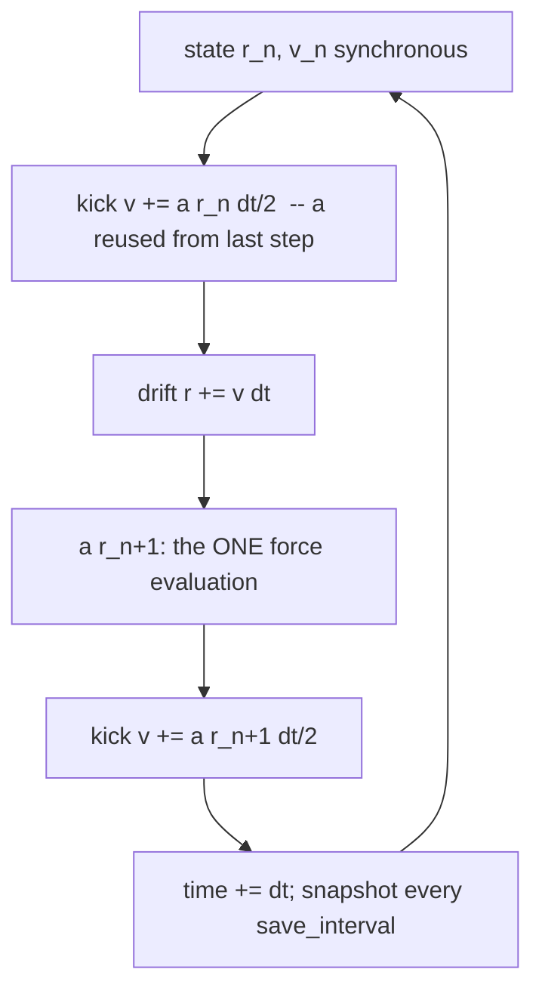

# Integration — kick-drift-kick leapfrog

`cosmo/integrator.py::LeapfrogIntegrator`. Forces it calls: [forces.md](./forces.md).
Memory budget of the energy diagnostic: [../numerics/memory-and-parallelism.md](../numerics/memory-and-parallelism.md).



## Step contract
- KDK with SYNCHRONOUS (r, v) at step boundaries: second order, symplectic, time-reversible.
  No pre-kick or velocity staggering is needed (none exists in the code; an older Lode note
  claiming one was never implemented).
- **One force evaluation per step.** The opening kick needs a(r_n), exactly what closed the
  previous step; `_total_forces_at_current_state` reuses it when positions and the force
  switches (`use_external_nodes`, `use_dark_energy`, grid identity) are unchanged, else
  recomputes. Bit-identical to the two-evaluation KDK (oracle test), ~1.5–1.6× faster at
  N = 2000–8000. Anything that resets positions between steps (legacy calibration) or toggles
  nodes invalidates the reuse automatically.
- **Adaptive sub-stepping** (`node_substep_threshold > 0` AND `node_substeps > 1`, clamped
  ≤ `MAX_NODE_SUBSTEPS = 64`): if any particle is within threshold × S_ref of a node (S_ref =
  node softening length, else median node NN spacing), the step runs as m KDK sub-steps.
  Drag and time advance apply once per global step.
- `evolve(t_end_s, n_steps, save_interval)`: dt = (t_end_s − time)/n_steps; `particles.time`
  starts at 0, so t_end_s is the DURATION. (`CosmologicalSimulation.run(t_end_Gyr=...)` is
  likewise passed the duration by `factories.run_and_extract_results` — the name is a misnomer.)

## Timestep limits (`CosmologicalSimulation._validate_timestep`)
- dt > 0.05 Gyr ⇒ prints the required n_steps and exits (`sys.exit(1)`); 0.04–0.05 ⇒ warning.
- Lesson behind it: 150 steps over 20 Gyr (dt 0.133 Gyr) injected ~1600% energy and made
  matter-only out-expand ΛCDM; 500 steps (0.04 Gyr) was clean.
- Convention: n_steps = ceil((13.8 − t_start)/0.04) → 273 at t_start 2.9 (sweep default);
  production 546 (20 Myr) or 1092 (10 Myr); hero runs 5k–12k steps.
- Finer dt does NOT tame node slingshots (force-law issue, PF9).

## Snapshots and diagnostics
- Snapshot dict: `time_s`, `positions`, `velocities`, `accelerations` (copies; all particles,
  inner AND outer).
- Energy (KE + softened pairwise PE) sampled ~10× per run (5× above 20k particles);
  `potential_energy` is chunked by a byte budget (`_PE_BLOCK_BYTES = 64 MB`). Monitoring only:
  external tides do work, so energy is not conserved in External-Node runs.
- Warning signs of a bad dt: sudden velocity jumps, energy drift ≫ 1% in matter-only runs,
  matter-only above ΛCDM.

## Performance notes
Per-particle Python objects (`Particle`, list loops in `get_positions`/`update_*`) cost ~1/3 of
a step at N = 2000–8000 after the force reuse; a struct-of-arrays `ParticleSystem` is the next
speed-up if throughput matters on CPU.

```python
from cosmo.integrator import LeapfrogIntegrator
ig = LeapfrogIntegrator(particles, hmea_grid, softening_per_Mobs_m=1.0 * Gpc_to_m,
                        use_external_nodes=True, use_dark_energy=False,
                        force_method="auto", node_substep_threshold=0.0)
snaps = ig.evolve(t_end_s=10.9 * 1e9 * 365.25 * 24 * 3600, n_steps=546, save_interval=10)
```

Tests: `tests/test_integrator.py`, `tests/test_force_reuse.py` (bit-identical oracle, one
evaluation per step, reset/toggle invalidation), `tests/test_slingshot.py` (substeps),
`tests/test_potential_energy_memory.py`, `tests/test_early_time_behavior.py`.
