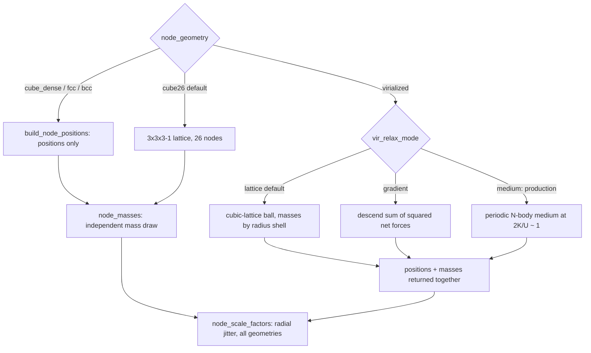

# Node geometry — where the HMEA nodes sit

`cosmo/node_geometry.py` builds node layouts; `HMEAGrid._create_grid` (cosmo/particles.py)
consumes them. Force law on the nodes: [forces.md](./forces.md). Why "virialized" means the
periodic medium: [../findings/methodology.md](../findings/methodology.md) (PF8/PF21).



## Catalogue
| id | nodes | notes |
|---|---|---|
| `cube26` | 26 | default; the clean single shell where "S" means what it says |
| `cube_dense` | n³−1 (n=5 → 124) | `n_per_side` odd ≥ 3 |
| `fcc` / `bcc` | ~86 / ~386 at `n_shells=2` | most nodes sit far beyond the horizon (PF7) |
| `virialized` | exactly `vir_n_nodes` | COUPLED positions+masses via `build_virialized_grid`; `build_node_positions("virialized")` raises |
Hollow shells are excluded by design (Birkhoff ⇒ no interior force). `geometry_kwargs=
{"normalize_nearest": True}` rescales a lattice so its nearest node sits at S (the fair
cross-geometry control: same per-node mass, same nearest distance).

## Virialized modes (`vir_relax_mode`)
- **`medium` (the honest structure, all production runs)**: `relax_virialized_medium`
  (cosmo/virialized_medium.py) evolves n_nodes+1 bodies in a PERIODIC box (minimum image =
  infinite tiling, so the mean background force cancels) with warm, undamped leapfrog to virial
  equilibrium 2K/|U| ≈ 1 (~1.1 held). Softening = 2 × mean spacing keeps it collisionless
  (smaller ⇒ numerical heating, 2K/|U|→~15). Masses log-normal `exp(σ g)` with
  σ = `vir_mass_spread`; node 0 = "us"/progenitor at the origin with mass
  `vir_center_mass_frac` × mean. Then: DROP node 0 (in the sim, "us" is the particle cloud),
  rescale so the HMEA NN spacing == S, mean-preserve masses to M_ext_kg. Homogeneous on
  average, disordered, locally clumpy. Uses only n_nodes, σ, `vir_s_metric`, seed,
  `vir_center_mass_frac`; the mass rule/segregation/extent/relax knobs are ignored.
  Disk-cached (git-tracked) at `data/vir_medium/medium_N{n_nodes+1}_sig{σ}_seed{s}_cm{vcm}.npz`.
- `lattice` (default value, legacy): analytic cubic-lattice ball with masses by radius shell;
  `vir_relax_steps` is a balance LEVEL (0 = Fibonacci "realistic" layout). Its centre force
  balance was a central-mass artifact (PF8).
- `gradient` (legacy Option B): descends Σ|a_i|² from the realistic blob; `vir_relax_steps` =
  iterations, `vir_relax_rate`, `vir_hold_outer_frac`. Never reaches balance.
- Lattice/gradient knobs: `vir_extent` (radial RANGE [0.5S, (0.5+extent)S]), `vir_mass_rule`
  (`radial` deterministic | `massfunc` log-normal sorted to radius), `vir_segregation` (0 =
  decoupled), `vir_extent_couples_nodes` (PF14: N = round(N0·extent³) keeps ball density; no-op
  at extent 1).

## Contracts
- **S = nearest-neighbour spacing** (`nearest_neighbour_spacing`, median default): one global
  rescale pins the realized statistic to S exactly.
- **Mean-preserving**: mean(node mass) == M_ext_kg (rtol 1e-12) for every mode.
- **Seeded & isolated**: `default_rng(node_mass_seed)` only; independent of the particle RNG.
  Seeds that reshape the grid (medium; massfunc with σ>0) key the cache via `virseed`
  (`vir_seed_reshapes_grid`).
- **PF1**: M_ext = 0 ⇒ all node masses 0 ⇒ zero tide, for every geometry.
- Observational gate: no HMEA within ~15 Gpc of us; for the medium d_near/S is a (seed, σ)
  property, so the gate is a per-seed minimum S (all production cells pass by 3–8×).
- σ ≲ 1 keeps the tidal field near-sourced; wide σ + segregation strands mass on inert far
  nodes (PF20). Production: σ = 0.5, 300 nodes.

```python
from cosmo.node_geometry import build_virialized_grid, nearest_neighbour_spacing
Gpc = 3.0857e25
pos, m = build_virialized_grid(89 * Gpc, n_nodes=300, M_ext_kg=3000e53, vir_relax_mode="medium",
                               vir_mass_spread=0.5, center_mass_frac=1.0, seed=0)
nearest_neighbour_spacing(pos) / Gpc   # == 89.0 ; m.mean() == 3000e53
```

Tests: `tests/test_node_geometry.py`, `tests/test_virialized_grid.py`,
`tests/test_virialized_medium.py`, `tests/test_node_geometry_anisotropy.py`,
`tests/test_virialization_validation.py` (legacy force-balance metric).
Figures: `_gen_fig_meta_structure.py` (paper §2.1), `_generate_ws8_figs.py`, `visualize_geometries.py`.
