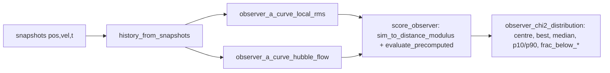

# Observers — μ(z) from a particle's vantage

`cosmo/observer_distance.py` (pure functions, no I/O). The default a(t) is the inner cloud's
RMS radius about its centre of mass; an observer sitting on particle p sees a different,
anisotropic expansion. Why the BEST observer is the headline: [../findings/methodology.md](../findings/methodology.md)
(PF13, PF17). Scoring kernel: [hubble-diagram.md](./hubble-diagram.md).



## Observer definitions
- `local_rms` (default): a_p(t) = RMS distance about p of p's neighbour set, fixed once at the
  final snapshot and tracked by identity (Lagrangian). Centre limit: COM observer + all
  neighbours reproduces the centre a(t) exactly (`center_a_curve` re-implements
  `CosmologicalSimulation._calculate_expansion_history`; tests pin it).
- `hubble_flow`: per snapshot fit H_p = Σ v_r r / Σ r² of p's neighbours about p (the
  `anisotropy.hubble_dipole` slope, centred on p and its velocity); a_p = exp(∫H_p dt).
- `k` = neighbour count; `ALL_NEIGHBOURS = -1` = whole cloud. Only k=-1 (or very large k) is
  well-sampled at N ≤ ~10k (PF17).

## Scoring contract
- `score_observer` uses the SAME authoritative χ² as the sweep but OMITS the growth anchor (an
  off-centre observer legitimately has a different total growth); it reports `growth_factor`.
- `observer_chi2_distribution(pos, vel, t, t_start_Gyr, pantheon, definition, k, observers,
  lcdm_ref, eds_ref)` returns best/median/p10/p90 + `frac_below_lcdm` / `frac_below_eds`.
- `fraction_at_or_below(chi2, threshold)`: fraction of FINITE values ≤ threshold; monotone in
  threshold, NaN if none finite.
- `strided_observer_sample(n_total, sample)` picks the scored observers deterministically.

## In the sweep
`score_observers=True` (all real configs) → `compute_pantheon_metrics` scores
`observer_sample` observers per cell and sets `chi2_dof = best_observer_chi2`, keeping
`center_chi2_dof`. Needs per-cell snapshots (`SimResult.snapshots`), so a cache hit must carry
`best_observer_chi2` or the cell re-runs. Observer params key the cache (PF-OBSCACHE). A
failure inside observer scoring emits a RuntimeWarning and falls back to the centre χ².

```python
from cosmo.observer_distance import (history_from_snapshots, observer_chi2_distribution,
                                     strided_observer_sample, ALL_NEIGHBOURS)
pos, vel, t = history_from_snapshots(sim.snapshots)
dist = observer_chi2_distribution(pos, vel, t, 2.9, pantheon, definition="local_rms",
                                  k=ALL_NEIGHBOURS, observers=strided_observer_sample(pos.shape[1], 256),
                                  lcdm_ref=0.436, eds_ref=0.843)
print(dist["best_chi2_dof"], dist["median"], dist["frac_below_lcdm"])
```

## Invariants
- Centre observer + all neighbours == centre a(t) (reproduction test).
- Observers never change the sim or its a(t): pure post-processing.
- A large per-observer spread is itself an anisotropy signal (PF2).

Tests: `tests/test_observer_distance.py`, `tests/test_overarching_sweep.py::TestObserverInSweep`.
Figure: `_generate_observer_figs.py` → `results/figures/ws8/observer_chi2_distribution.png`.
