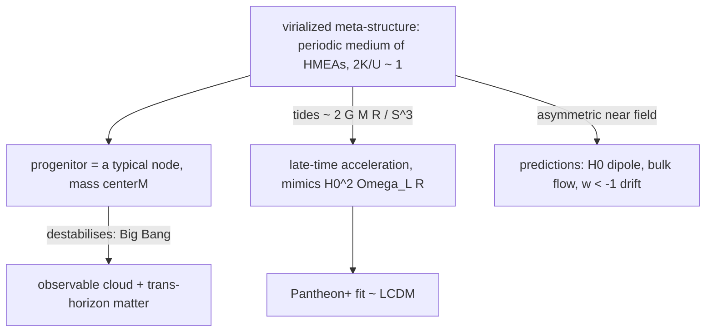

# Theoretical framework — External-Node Model + Progenitor Hypothesis

Toy model under test (draft paper `docs/VirializedMetaStructure.tex`, see
[../paper-reference.md](../paper-reference.md)): can Newtonian tidal forces from
trans-horizon Hyper-Massive External Attractors (HMEAs) reproduce late-time acceleration
without Λ? Proof of concept only — no claim of physical reality.



## Mechanism
- A discrete external mass distribution evades Birkhoff (a smooth shell would exert no force).
  A test galaxy at radius R ≪ S from us feels a_tid ≈ G M/(S−R)² − G M/S² ≈ 2 G M R/S³ toward
  the nearest node: LINEAR in R, the same form as the Λ term H0² Ω_Λ R.
- Estimate: H0² Ω_Λ ≈ 2 G M/S³ ⇒ S ≈ (2GM/(H0²Ω_Λ))^{1/3} ≈ 39 Gpc for M = 5e55 kg (500 M_obs).
  The sim uses the full node sum; the label Ω_Λ,eff = G M/(S³H0²) is order-of-magnitude only.
- Vacuum rearrangements of node mass are TRACELESS to linear order: they change shear, not the
  isotropic expansion (PF2) — hence the M/S³ degeneracy of the isotropic fit (PF3).

## Progenitor Hypothesis (settled semantics)
The Big Bang was the destabilisation of one node of the meta-structure; expansion from a
pre-existing equilibrium point explains isotropy without fine-tuning our position. The
progenitor's mass (centerM) is ONE parameter acting in both epochs: pre-BB a member of the
medium, post-BB the observable universe plus matter beyond it. Distinguished value
centerM = M_value (a typical node) — also the structurally most robust regime (PF25).
Mechanics: [centerm-outer-mass.md](./centerm-outer-mass.md).

## Virialized meta-structure
"Virialized" = virial equilibrium (velocity-dispersion supported, members orbit), realized as a
snapshot of an infinite periodic self-gravitating medium: homogeneous on average, locally clumpy.
Node dynamical times ≫ 8 Gyr, so frozen nodes are fair boundary conditions. The ordered lattice
survives only as the analytic idealization. HMEAs: ancient, accretion-free black holes
("dark giants"): EM-silent, Hawking temperature ~1e-83 K, visible only through tides.

## Predictions (paper §predictions)
1. Phantom drift: as R→S the tide grows as (S−R)⁻², so effective w drifts below −1.
2. H0 dipole from the asymmetric near field; quoted 4.6% (grid) to 11.3% (single node) in the
   paper via `compute_predictions.py` on the legacy M9000/S38 lattice config.
3. CMB "Axis of Evil" alignment — argued from CUBIC lattice symmetry (face/edge/corner shells).
   Open: re-derive for the disordered medium, which has no lattice axes.
4. Dark flow: net tidal pull on the whole bubble (~320–790 km/s quoted); the sims show a
   coherent ~30 Gpc drift of the cloud (PF18) — magnitude reconciliation is open.

## Scope
In: late-time expansion t = 2.9 → 13.8 Gyr (z ≲ 2.3), Newtonian gravity in flat space.
Out: inflation, nucleosynthesis, CMB spectrum, BAO, structure formation, GR (metric, junction
conditions). The speculative Great Metabolism cycle (universes feed nodes, nodes re-ignite)
is paper-only; nothing in code tests it.

```python
from cosmo.constants import ExternalNodeParameters, CosmologicalConstants as C
p = ExternalNodeParameters(M_ext_kg=5e55)
p.calculate_required_spacing(Omega_Lambda_target=0.7) / C.Gpc_to_m   # S from G M/(H0^2 Omega_L)
```
Note: `calculate_required_spacing` uses G M/(H0² Ω_Λ) (no factor 2), giving ~31 Gpc; the
paper's single-node estimate with the factor 2 gives ~39 Gpc.
