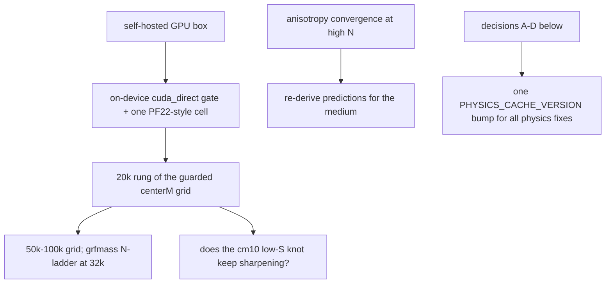

# Roadmap — open work and pending decisions

Everything implemented lives in the domain files; this file holds only what is NOT done.
Evidence base: [../findings/summary.md](../findings/summary.md). GPU/HF detail:
[scale-out-gpu-hf.md](./scale-out-gpu-hf.md).



## Science / compute
1. **GPU**: validate `cuda_direct` on the real device (run `tests/test_cuda_direct.py` without the
   simulator; one end-to-end cell vs `numba_direct` to ~1e-3 in best_obs/growth/knot). Watch
   float64 throughput on consumer GPUs.
2. **20k rung** of the guarded campaign (72 cells), then 50–100k; grfmass N-ladder + seed×σ at 32k.
3. **Anisotropy convergence**: shear / dipole vs N (the discriminating signal is the noisiest
   quantity; no converged anisotropy number exists yet).
4. **Predictions for the medium**: H0 dipole, bulk flow and the Axis-of-Evil argument were
   derived on the cubic lattice (M9000/S38); redo them on the paper-candidate medium cells.
   Reconcile the ~30 Gpc coherent drift (PF18) with the quoted ~320–790 km/s dark flow.
5. **Shape metric in the pantheon objective**: only total growth is gated; add an a(t)-shape /
   size agreement term (PF20 gap).
6. **Full-covariance χ²** (Pantheon+ STAT+SYS covariance; hook noted in `cosmo/pantheon.py`).
7. **Local observers** (finite k) are only meaningful at much higher N (PF17).
8. Future init option: real galaxy catalogue (keep off the anisotropy path: survey mask).

## Decisions for Martin (found 2026-09-28, nothing changed yet)
- **A. Year length**: `Gyr_to_s` (365 d) vs the 365.25 d clock (~0.07% t_start mismatch) —
  unify, with a cache bump ([../practices/unit-conventions.md](../practices/unit-conventions.md)).
- **B. Correlated node perturbations**: `node_masses` and `node_scale_factors` share one draw;
  decouple (new stream + key slug) or document as intended ([../physics/forces.md](../physics/forces.md)).
- **C. Paper legacy R² section**: the abstract and sec:results still quote R² values from the
  pre-EdS calibrated-velocity physics — re-run under current physics, reframe, or drop
  ([../paper-reference.md](../paper-reference.md)).
- **D. Reproducibility**: the self-healing pool driver (`results/logs/cmx3_pool_driver.sh`) and
  the other campaign drivers are gitignored; commit a generalized driver (e.g. `sweeps/pool_driver.sh`).

## Housekeeping
- `bash.exe.stackdump` (untracked crash dump) at the repo root: delete; consider ignoring `*.stackdump`.
- `CosmologicalSimulation.run(t_end_Gyr=...)` actually takes the DURATION: rename when touched.
- Per-particle Python objects cost ~1/3 of a step: struct-of-arrays `ParticleSystem` if CPU
  throughput matters again.
- Many modules carry history-style comments ("Section 4", "WS4", "byte-identical"): trim when
  editing those lines, don't mass-rewrite.

```bash
# 20k rung, one cell (20000p / 2000 steps, knot guard on). The cmx4 configs do NOT set
# force_method, so add "force_method": "cuda_direct" for the GPU box (auto = CPU Barnes-Hut).
python sweep.py --config sweeps/centerm_campaign/cmx4_s0_cm3000.json
```
