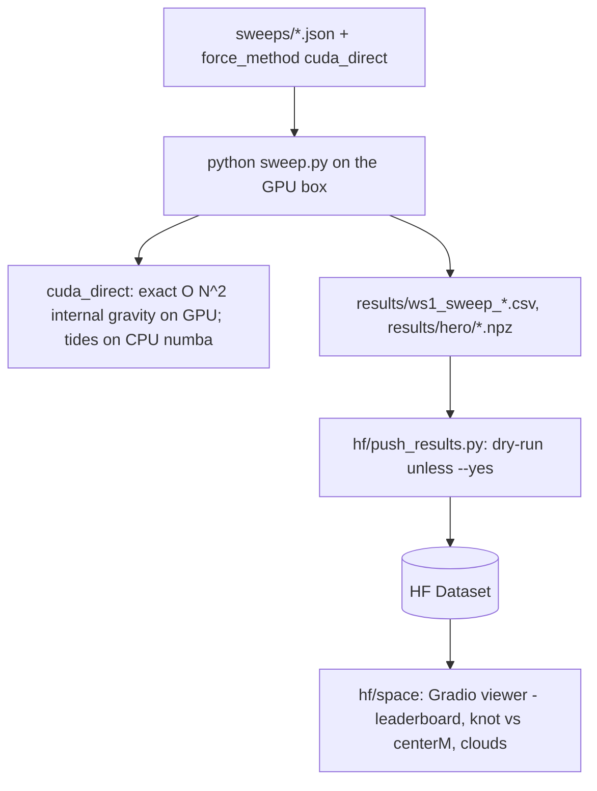

# WS7 — self-hosted GPU compute + HuggingFace results/viewer

Decision (Martin, 2026-07-20): compute runs on a self-hosted CUDA GPU box (to be bought); HF is
ONLY a versioned results store (Dataset) + a public viewer (Space). No HF Jobs, no pay-per-use
cloud GPU. CPU throughput is the reason: 8k campaign ≈ 10–11 days, a 20k campaign ≈ 4–7 weeks
on the current 8-core box. Open steps: [roadmap.md](./roadmap.md).



## Status
- **Built**: `force_method="cuda_direct"` (cosmo/cuda_direct.py, `CudaDirectSolver`, one thread per
  particle, Plummer-softened, mirrors numba_direct term for term). Explicit opt-in only: `auto`
  never picks it, cache slug `cudadirectfm`. Raises if no CUDA backend (no silent CPU fallback).
- **Gate**: `tests/test_cuda_direct.py` checks cuda_direct == numba_direct to ~1e-9 under the
  CUDA simulator (`NUMBA_ENABLE_CUDASIM=1`, subprocess) — correctness without a GPU.
- **HF scaffold**: `hf/push_results.py`, `hf/space/{app,viz}.py`, `hf/preview.py` (local preview,
  no HF needed). Martin logs in and publishes; the agent never handles credentials, and pushing
  publishes results publicly — his call.

## Not yet done
- On-device validation (drop the simulator; one end-to-end cell vs numba_direct, best_obs /
  growth / knot to ~1e-3) before any large GPU sweep.
- First GPU sweep: the 20k rung (`sweeps/centerm_campaign/cmx4_*.json`, add
  `"force_method": "cuda_direct"`), then medium seed×σ + grfmass N-ladder at 32k, then 50–100k.
- Consumer GPUs have weak float64; the sim needs float64 (masses ~1e52 kg). If throughput is
  the bottleneck, a per-block reduction / mixed-precision kernel is the next optimization.
- Non-goal: Barnes-Hut on GPU (direct sum is simpler and fast enough to ~1e5 particles).

```bash
python hf/preview.py                      # local leaderboard + plots, no HF account
python hf/push_results.py --repo NAME/progenitor-node-results   # dry run (default); --yes publishes
```
