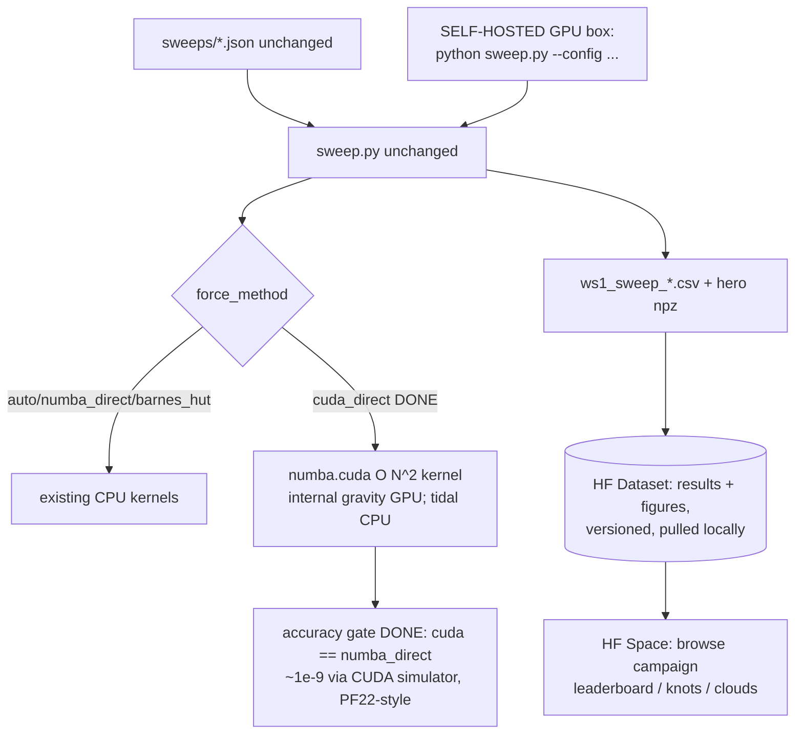

# WS7 — GPU (self-hosted) + HuggingFace results/viz Scale-Out (TRIGGERED 2026-07-05)

Back to [deeper-exploration-roadmap.md](./deeper-exploration-roadmap.md). Phase 3.

## DECISION (Martin, 2026-07-20)
- **Compute = SELF-HOSTED GPU** on a new machine Martin will buy (his current box is
  Win10-EOL / no Win11). NOT HF Jobs / pay-per-use cloud GPU. The `cuda_direct` runner
  is a plain `python sweep.py --config` so it runs anywhere with a CUDA GPU.
- **HuggingFace = results STORE + a visualization SPACE only** (no compute): push the
  `results/ws1_sweep_*.csv` + figures as a versioned HF Dataset, and a Space app to
  browse the centerM campaign / leaderboards / clouds publicly. Original WS7 dataset
  intent + a viewer; the enthusiastic ask.
- **cmx4 (20k CPU) auto-chain CANCELLED** (was projected ~4–7 weeks on this CPU). The
  20k/50k/100k rungs move to the self-hosted GPU. cmx3 (8k) still finishes on CPU
  (~10–11 days) as the honest 2k→8k N-stability rung.

## Status: `cuda_direct` kernel BUILT + gate-tested (2026-07-20); GPU hardware pending

The original gate ("scripts + numbers good, CPU convergence plateaued") is satisfied:
- WS1 sweep tool stable; figure layer uniform; authoritative chi2 (PF11).
- Headline geometry chosen and converged: the virialized MEDIUM (PF21), fit ~0.44
  converged in N (8k→32k), GRF seed, and mass split (PF23 ladder).
- The remaining questions are pure THROUGHPUT: wider seed × σ × M/S × init sweeps at
  ≥32k particles. One 32k/2500-step cell ≈ 1.5–4 h on the 8-core CPU (no local GPU);
  a meaningful sweep (hundreds of cells) is CPU-infeasible. The centerM campaign
  timing confirmed it: cmx3 8k ≈ 10–11 days, cmx4 20k ≈ 4–7 weeks CPU.

## `cuda_direct` — IMPLEMENTED
`force_method="cuda_direct"` (cosmo/cuda_direct.py: `CudaDirectSolver` +
`_cuda_direct_kernel`, one thread/particle, exact Plummer-softened O(N²)). Mirrors
`cosmo.numba_direct` term-for-term; tidal/external force stays on the CPU numba path
(O(N·M), M~300 negligible). Wired: constants.valid_fm, integrator dispatch branch
(`calculate_internal_forces_cuda_direct`), cache slug `cudadirectfm` (keyed==run, PF22
machinery; "auto" path + existing keys byte-identical — explicit opt-in only). GATE:
`tests/test_cuda_direct.py` (7 tests) validates cuda_direct == numba_direct to ~1e-9
via the CUDA SIMULATOR (`NUMBA_ENABLE_CUDASIM=1`, isolated subprocess) — correctness
proven WITHOUT a GPU; the solver raises a clear error (no silent CPU fallback) when no
CUDA backend is present. **Real-GPU performance validation deferred to Martin's box.**

## Design (concrete, small-surface)

1. **`force_method="cuda_direct"` — DONE** (see "IMPLEMENTED" above). Direct-sum on GPU
   beats CPU-Barnes-Hut up to ~100k+ particles and is bit-checkable; the CPU kernels
   stay the fallback. NO sweep/config/CSV changes — the runner invokes the same
   `python sweep.py --config` with `force_method: "cuda_direct"` in the JSON.
2. **Accuracy gate — DONE via simulator** (`tests/test_cuda_direct.py`, ~1e-9). The
   remaining step is on-GPU: re-run the same gate on-device + a PF22 end-to-end cell
   (best_obs/growth/core/knot to ~1e-3) before trusting a big sweep.
3. **HuggingFace = results store + viewer ONLY** (no compute):
   - **Dataset = durable results store** (original WS7 intent): push
     `results/ws1_sweep_*.csv`, `results/hero/*.npz`, figures per run tag; pull
     locally for `--plots-only` / `load_best_config`. Versioned + shareable.
   - **Space = public visualizer**: a Gradio app that loads the Dataset and browses
     the centerM campaign — universe-fit leaderboard, knot-vs-centerM, cloud figures.
   - Scaffolded under `hf/` (push script + Space app + local preview). Martin does the
     auth + push (agent never enters credentials; pushing publishes results — his call).
4. **Compute = self-hosted GPU** (Martin's new box). A 32k direct-sum step ≈ 1e9
   pair-forces ≈ ms-scale on a modern GPU → a 2500-step sim in minutes vs 1.5–4 h CPU.
   The cache/CSV resume logic already makes runs restartable across sessions.

## Open items

- **GPU box** (Martin buying) — real-GPU validation of `cuda_direct`: run
  `tests/test_cuda_direct.py` on-device (drop the simulator), then a small
  cuda_direct-vs-numba_direct end-to-end cell (best_obs/growth/knot to ~1e-3, PF22
  style) before trusting a big sweep. Consumer GPUs have weak float64 — the sim needs
  float64 (masses ~1e52 kg); if float64 throughput is the bottleneck, a mixed-precision
  or per-block-reduction variant is the next optimization (naive kernel is correct now).
- **First GPU sweep** (proposed): medium seed×σ grid + the grfmass N-ladder at 32k
  (PF23 follow-on), then the 50–100k full centerM grid (the cmx4/cmx-full replacement).
- **HF Dataset + Space** — tooling scaffolded (see below); Martin does the auth + push
  (credentials never entered by the agent; pushing to HF publishes results — his action).

## Non-goals

- No BH-on-GPU (complex, unnecessary at N ≤ ~100k for direct-sum GPU).
- No pay-per-use cloud GPU / HF Jobs for compute (Martin runs his own box).
