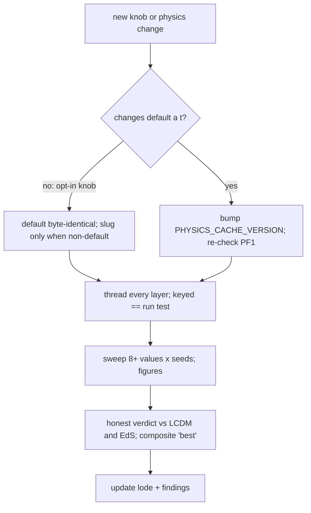

# Practices

How work is done on this project. Units: [practices/unit-conventions.md](./practices/unit-conventions.md).
Why each rule exists: [findings/methodology.md](./findings/methodology.md).



## Honest reporting (non-negotiable)
- Always quote the ΛCDM (0.436) and EdS-null (0.843) references next to any χ²/dof.
- "Best" = the composite universe-fit criterion (best-observer χ² ≤ ~0.46 AND growth anchor AND
  knot ≥ 0.9 AND no HMEA within 15 Gpc), never χ² alone; a cell that fails structure is
  "best-χ² (fails structure)", never "best".
- Headline χ² = best observer (well-sampled, k=-1) PLUS the fraction below ΛCDM/EdS; centre is
  context. Report multiplicity (how many distinct configs qualify), not one point.
- Negative and limiting results are wanted if true ("matches, does not beat ΛCDM"). Never
  present a better-than-real fit; flag anything at a grid edge or near a threshold.
- Word choice: testing / exploring / consistent with — not proven / optimal.

## Invariants every change must keep
- PF1: M_ext = 0 reproduces EdS (`tests/test_matter_only_consistency.py`).
- Node-mass knobs are mean-preserving; `observable_mask` alone defines what a(t) measures.
- Default parameters stay byte-identical unless a physics change is intended.

## Adding a knob (keyed == run)
1. Field on `SimulationParameters` (+ `ExternalNodeParameters` if node-side), validated.
2. Field on `SweepConfig`; read in `sweep._make_sweep_config_for_cell` AND `_build_sim_params`
   (the one builder shared by sims and figures); CLI flag in `cosmo/cli.py` if user-facing.
3. Slug in `build_cache_name` ONLY when non-default; a digit-then-alpha token, no underscores.
4. Tests: the key AND the SimulationParameters the sim receives both carry the value; default
   key unchanged.
```python
# SweepConfig
my_knob: float = 0.0          # 0.0 = legacy behaviour, no slug
# build_cache_name
if getattr(config, "my_knob", 0.0) != 0.0:
    parts.append(f"{config.my_knob}myknob")
```

## Changing physics
Bump `PHYSICS_CACHE_VERSION` when a(t) changes for a fixed parameter tuple (and log why in the
history comment). A performance refactor must be bit-identical, proven by an oracle test and
an unchanged dump of every existing sweep cell/key.

## Sweeps
- A sweep is ≥ 8 values (log-spaced for multiplicative knobs) × seeds; 4 points is a probe.
- Estimate wall time before any long launch; run detached and resumable; size parallel pools
  by free RAM ([numerics/memory-and-parallelism.md](./numerics/memory-and-parallelism.md)).
- Pantheon co-fits: ternary S search, `s_knot_guard` ON, `score_observers` ON with k=-1.
- Actually run new knobs and feed the real numbers into figures and the paper — no untested
  default-off parameters left lying around.
- Every claim gets a saved figure; look at it (a good χ² can sit on a runaway edge).
- Compare across resolutions by qualification counts, not third decimals.

## Code style
- Match the surrounding module; SI with unit suffixes; concise docstrings (one-line summary,
  detail only for physics, derivations, empirical thresholds).
- Comments describe current behaviour; history belongs in git and lode/tmp, not in code.
- Tests are first-class (≥ docs): unit + integration, hermetic (synthetic SNe fixture).

## Repository hygiene
- Never commit `results/` or `data/*.csv`; paper figures are copied into `docs/`.
- `data/vir_medium/*.npz` (relaxed medium structures) IS tracked: the sweep reuses them.
- Session scraps go in `lode/tmp/` (gitignored).
