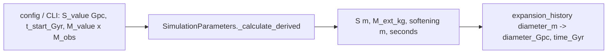

# Unit conventions

SI inside (m, s, kg, s⁻¹, m/s²); Gpc and Gyr only at I/O boundaries (CLI, configs, CSV, plots).
Variable names carry the unit: `_m`, `_s`, `_kg`, `_si` (rates in s⁻¹), `_mps2`, and
`_Gpc` / `_Gyr` / `_Mpc` for user-facing values. Distances in chat, figures and tables are
ABSOLUTE Gpc (never "0.8 S" ratios). Where the constants live: `cosmo/constants.py`.



## Constants actually used
| name | value | note |
|---|---|---|
| `CosmologicalConstants.Gpc_to_m` | 3.0857e25 | `Mpc_to_m` 3.0857e22 |
| `CosmologicalConstants.Gyr_to_s` | 3.1536e16 | **365-day year** |
| inline `1e9 * 365.25 * 24 * 3600` | 3.15576e16 | Julian year: integrator clock, `time_Gyr`, analysis |
| `M_observable_kg` | 1e53 | M_value and centerM are in these units |
| H0 | 70 km/s/Mpc → `LambdaCDMParameters.H0_si` | Ω_m 0.3, Ω_Λ 0.7 |
| `hbar`, `k_B`, `T_CMB_K` | 1.054571817e-34 J s, 1.380649e-23 J/K, 2.7255 K | only for `hawking_temperature_K(M_kg)` (paper sec:defenses) |

## Known inconsistency (open decision, not fixed)
Two year lengths coexist: `Gyr_to_s` (365 d) feeds `H_eds_at_time`, the pre-start boost and
`sim_distance`, while the integrator clock and `time_Gyr` use 365.25 d. Effects: the EdS start
time is read ~0.07% short (growth +~0.03%, inside the PF1 tolerance); μ(z) gets a constant
0.0015 mag offset that `fit_offset` absorbs. A fix changes every cached a(t) ⇒ needs a
`PHYSICS_CACHE_VERSION` bump; fold it into the next physics change.

## Radius vs diameter
- `rms_radius_m` = sqrt(mean r²) about the (masked) COM; `diameter_m` = 2 × rms_radius_m.
- `box_size` (e.g. `box_size_Gpc`, `box_size_m`) is a DIAMETER: the inner cloud's RMS radius is
  box/2 and its sphere radius (box/2)/√(3/5).
- `expansion_history[i]["scale_factor"]` = rms(t)/rms(0) (starts at 1, NOT the cosmological a).

```python
from cosmo.constants import CosmologicalConstants as C
S_m = S_Gpc * C.Gpc_to_m                        # boundary conversion, then SI inside
t_Gyr = snap["time_s"] / (1e9 * 365.25 * 24 * 3600)   # relative to t_start
```

Tests: `tests/test_units_validation.py`, `tests/test_radius_diameter_semantics.py`,
`tests/test_constants.py`.
