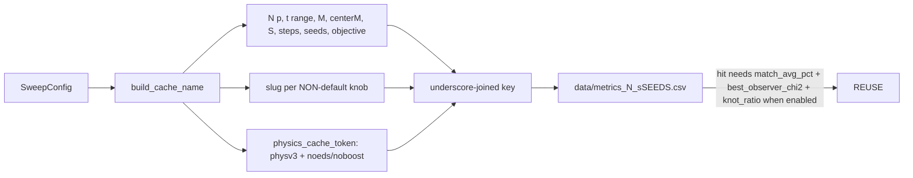

# Sweep cache — keys, physics version, concurrency

The metrics cache is keyed on PARAMETERS, so its one rule is **keyed == run**: every value that
changes a(t) or the stored metrics must be in the key, and every keyed value must actually reach
the sim. Driver: [sweep.md](./sweep.md). Lessons from the violations:
[../findings/methodology.md](../findings/methodology.md).



## Key anatomy (`cosmo/parameter_sweep.py::build_cache_name`)
Base: `{N}p_{t0}-{t1}Gyr_{M}M_{float(centerM)}centerM_{S}S_{steps}steps_{seeds}seeds_{obj}obj`.
Then, ONLY when non-default (so older keys never change):
| knob | slug |
|---|---|
| damping_factor | `{d}d` |
| node_mass_amplitude ≠ 0 | `{seed}nmseed_{amp}nmamp` |
| node_s_amplitude ≠ 0 | (`{seed}nmseed`) `{amp}nsamp` |
| init ≠ uniform_sphere | `{init}init` (+ `sphsup` for grf/grfmass sphere support) |
| geometry ≠ cube26 | `{geo}geo` |
| virialized | always `vn vx vr vsp vsg vsm vrx`; `{seed}virseed` if `vir_seed_reshapes_grid`; `1vxcouple`; mode ≠ lattice → `vrm vrr vho`; medium & vcm ≠ 1 → `{vcm}vcm` |
| outer_density_ceiling ≠ 1 / outer_particle_cap ≠ 0 | `{c}ceil` / `{cap}opc` |
| force_method ≠ auto | `{method without underscores}fm` |
| mass_randomize ≠ 0 | `{x}mrand` |
| node_softening_gpc ≠ 0 / node_force_law ≠ plummer | `{eps}nsoft` / `{law}nlaw` |
| substeps active | `{th}nsubth_{m}nsub` |
| start_size_scale ≠ 1 | `{x}ssz` |
| score_observers | `{def}obsdef_{n}obssamp_{k or all}obsk` |
Always last: `phys{PHYSICS_CACHE_VERSION}` + `noeds`/`noboost` when those IC flags are off.
NOT keyed (selection only, every per-S entry stays valid): knot-guard fields, `s_cofit_method`.

## Format constraints
- Parts are split on `_` and each part at its LAST digit (`Cache._split_key`: "1.0nsoft" →
  value "1.0", column suffix "nsoft"), so a slug must be `<value><alpha suffix>` with no
  underscore inside (hence `numbadirectfm`, `localrmsobsdef`) and no minus sign (k=-1 → `all`).
- CSV columns `key.{i}_{suffix}`; rows with different key shapes share one file, blank cells are
  skipped on reconstruction.

## PHYSICS_CACHE_VERSION (currently "v3")
Bump it whenever a change alters a(t) for a FIXED parameter tuple (ICs, force law, integrator,
softening, boost, units). History: v1 legacy calibrated ICs; v2 EdS-consistent ICs + pre-start
boost; v3 centerM as outer mass + frozen softening. A new optional knob instead gets a
non-default-only slug (no bump). Pure refactors that are bit-identical (e.g. the KDK force reuse)
need neither.

## Cache-hit requirements (`worst_callback`)
A cached entry is reused only if it has `match_avg_pct` (pantheon) or the lcdm metric keys, plus
`best_observer_chi2` when `score_observers`, plus `knot_ratio` when `s_knot_guard` — otherwise the
cell re-simulates. `SKIP_CACHE = True` bypasses the cache entirely.

## Concurrency (`cosmo/cache.py`)
- Exclusive (default): a lifetime `<file>.lock` (PID-checked; dead PIDs broken silently, live ones
  prompt) and whole-file rewrite every 5 s.
- Concurrent (`HMEA_CACHE_CONCURRENT=1`, set by `launch_sweep_detached.ps1 -Parallel N` and the
  pool drivers): no lifetime lock and no prompts; each save is read-MERGE-write under a short lock
  + atomic `os.replace`, every 15 s. N workers never lose each other's entries.
- Other caches: legacy velocity calibration (`data/velocity.*`, non-EdS path only) and relaxed
  medium structures (`data/vir_medium/*.npz`, git-tracked).

```python
import sweep
from cosmo.parameter_sweep import build_cache_name
cfg = sweep.load_config("sweeps/centerm_campaign/cmx2_s0_cm3000.json")
sc = sweep._make_sweep_config_for_cell(sweep.expand_grid(cfg)[0], cfg)
build_cache_name(sc, 3000, 89, 3000.0, [42])
# '2000p_2.9-13.8Gyr_3000M_3000.0centerM_89S_546steps_42seeds_pantheonobj_grfmassinit_sphsup_'
# 'virializedgeo_300vn_1.0vx_massfuncvr_0.5vsp_1.0vsg_medianvsm_1vrx_0virseed_mediumvrm_0.1vrr_'
# '0.3vho_2.0opc_1.0nsoft_localrmsobsdef_2000obssamp_allobsk_physv3'   (vcm = 1 -> no vcm slug)
```

Tests: `tests/test_ws4_cache_slug.py`, `tests/test_cache.py`, `tests/test_cache_concurrent.py`,
`tests/test_overarching_sweep.py` (keyed==run threading per knob, `TestVirializedSeedAxis`),
`tests/test_parameter_sweep_pantheon.py::TestPhysicsCacheVersionToken`.
