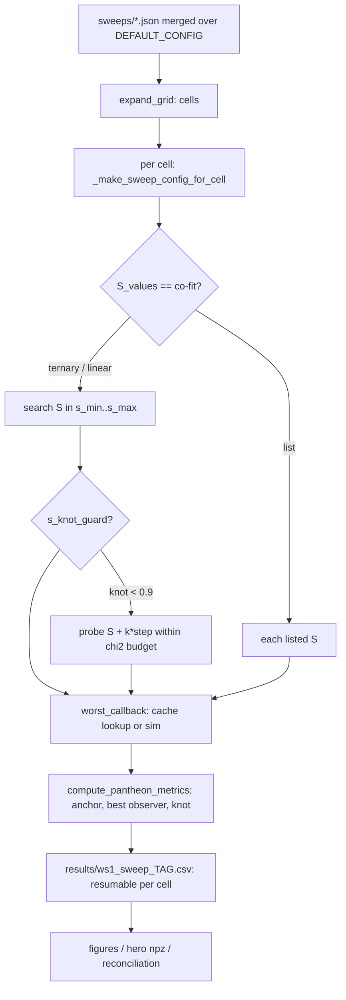

# Sweeps — `sweep.py` driver + `cosmo/parameter_sweep.py` library

The one config-driven, resumable, cached sweep runner. Cache-key rules:
[sweep-cache.md](./sweep-cache.md). Parallel runs and RAM: [../numerics/memory-and-parallelism.md](../numerics/memory-and-parallelism.md).
What the numbers mean: [../findings/summary.md](../findings/summary.md).



## CLI
```bash
python sweep.py --config sweeps/centerm_campaign/cmx3_s0_cm3000.json   # one config
python sweep.py --config cfg.json --no-resume        # recompute completed cells
python sweep.py --plots-only results/ws1_sweep_TAG.csv
python sweep.py --probe-only                         # time a few sims, exit
```
Other flags: `--tag`, `--results-dir`. The config key `skip_probe: true` skips the start-up
timing probe (required at high N).

## Config (JSON over `DEFAULT_CONFIG`)
- Axes (lists): `M_values`, `S_values` (`"co-fit"` or ints), `node_mass_amplitudes`,
  `node_s_amplitudes`, `node_mass_seeds`, `init_distributions`, `node_geometries`,
  `vir_mass_spreads` (virialized only), `outer_density_ceilings`; `centerM` scalar or list.
- Scalars: `particle_count` (default 400), `n_steps` (273), `t_start_Gyr` (2.9; duration is
  always 13.8 − t_start), `s_min_gpc`/`s_max_gpc`, `s_cofit_method` (`linear` default;
  production uses `ternary`), `objective` (`pantheon` default | `lcdm` legacy), every sim knob
  (`vir_*`, `node_softening_gpc`, `node_force_law`, `node_substep_*`, `start_size_scale`,
  `force_method`, `mass_randomize`, `outer_particle_cap`, `grf_support`, `particle_seed`),
  scoring (`score_observers`, `observer_definition`, `observer_sample`, `observer_k`), knot guard
  (`s_knot_guard`, `knot_guard_chi2_budget` 0.03, `knot_guard_min_ratio` 0.9,
  `knot_guard_step_gpc` 5), output (`tag`, `results_dir`, `figures_dir`, `save_snapshots`,
  `save_interval`, `skip_figures`, `resume`).
- Production shape (centerM campaign): medium · 300 nodes · σ 0.5 · grfmass · M 3000 ·
  Plummer 1 Gpc · ternary S co-fit [40,160] · s_knot_guard · score_observers with k=-1 ·
  outer_particle_cap 2 · 2000p/546 (cmx2) or 8000p/1092 (cmx3).
- Generators write config families: `sweeps/_gen_*.py` (e.g. `_gen_centerm_campaign.py`
  sets `vir_center_mass_frac = centerM/M_value`).

## Grid rules (`expand_grid`)
Full factorial, except at `node_mass_amplitude == 0` the seed list collapses to seed 42 when the
seed is a no-op. It does NOT collapse when the seed changes physics: `vir_seed_reshapes_grid`
(medium, or massfunc with σ>0) or `node_s_amplitude > 0`. `vir_mass_spreads` applies to
virialized cells only.

## S search (`ternary_search_S`, `linear_search_S`, `brute_force_search`)
Ternary is exact on the smooth pantheon landscape (== brute in validation) and cheapest; it is
the production method. Linear's early stop keys on `match_avg_pct` for pantheon (it once
compared zero-filled lcdm keys and pinned at s_max). Knot guard (`_knot_guard_select`): if the
winner's knot_ratio < min_ratio, probe S+step, S+2·step … ≤ s_max and accept the first
anchor-ok, knot-free S within the χ² budget; CSV records `knot_guard_moved/S_from`.

## Per-cell scoring and outputs
- `worst_callback` → metrics cache `data/metrics_{particles}_s{seeds}.csv` → on miss run the sim
  via `_build_sim_params` (single builder shared with the μ(z) figure, PF11).
- `compute_pantheon_metrics`: growth anchor, χ², best observer (headline `chi2_dof`),
  `center_chi2_dof`, fractions, `knot_ratio` (needs snapshots ⇒ observer runs re-simulate).
- `results/ws1_sweep_<tag>.csv` columns: M_factor, S_gpc, centerM, outer_density_ceiling, knob
  columns, vir_mass_spread, chi2_dof, chi2, chi2_lcdm, chi2_eds, R2, n_sne_used,
  growth_factor, growth_target, anchor_ok, runaway, match_avg_pct, diff_pct,
  best_observer_chi2, center_chi2_dof, observer_median_chi2, frac_below_lcdm, frac_below_eds,
  knot_ratio, knot_guard_moved, knot_guard_S_from. `sweep_results_pantheon_<tag>.csv` = best
  isotropic subset (`hubble_diagram_nbody.py --from-best-config`).
- Resume granularity = one completed cell (a co-fit cell ≈ 6–7 sims).
- `save_snapshots` writes median-centred downsampled snapshots to `results/hero/<tag>.npz`.

## Running at scale
- Never launch blind: estimate wall time first (`_calibrate_runtime.py` for the core_v3 family;
  otherwise time one cell).
- `launch_sweep_detached.ps1` (Windows, Start-Process, survives restarts): static `-ArmSet`
  lists (corev3, localized*, hero, rounder), `-Parallel N` (sets `HMEA_CACHE_CONCURRENT=1`),
  `-Stop` kills shell + python children and clears stale locks, `-Force`, `-NoResume`.
- The centerM campaigns (cmx2/cmx3) ran via a self-healing bash `xargs -P` pool driver that
  lives only in gitignored `results/logs/` (not reproducible from the repo; see roadmap).
- Verdict/ranking scripts: `sweeps/_universe_fit_rank.py` (composite criterion),
  `sweeps/_cmx2_verdict.py` (prefix-parameterized guarded verdict), `sweeps/_best_compare_figs.py`.

Tests: `tests/test_overarching_sweep.py`, `tests/test_parameter_sweep.py`,
`tests/test_parameter_sweep_pantheon.py`, `tests/test_cofit_validation.py`,
`tests/test_sweep_resume.py`.
