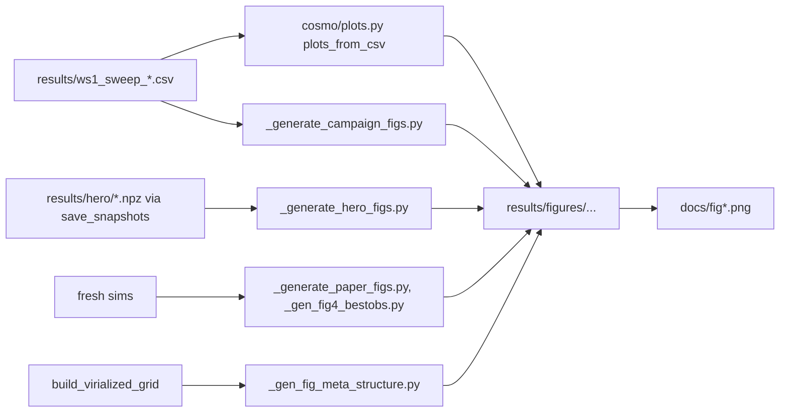

# Figures and one-off scripts

Every claim gets a saved PNG. Shared helpers: `cosmo/plots.py` (style, `figure_path(ws, name)` →
`results/figures/<ws>/<name>.png`, git-rev footer, CSV → heatmaps) and `cosmo/visualization.py`
(3D axes, universe sphere, filenames/titles). `results/` is gitignored; the paper's figures are
copied into `docs/` (only `docs/**/*.png` is tracked). Sweep outputs: [sweep.md](./sweep.md).



## Paper figures (docs/)
| file | source |
|---|---|
| `fig_meta_structure.png` | `_gen_fig_meta_structure.py` (§2.1 node points, CLI-parameterized, σ=1) |
| `fig1-3_4f97dec.png` | legacy `run_simulation.py` size/rate comparison plots (pre-EdS physics) |
| `fig4_pantheon.png` (+ `.summary.json`) | `_gen_fig4_bestobs.py` (best-observer μ(z), M300/S20/σ6 100k) |
| `fig5-7_hero_*_66fb244.png` | `_generate_hero_figs.py` from `results/hero/*.npz` (multiplicity, 100k cloud, χ² ladder) |
| `fig8_centerm_knot.png`, `fig9_universe_candidates.png` | copies of centerM-campaign figures (`results/figures/centerm/`: knot vs centerM, best_compare_v3); `sweeps/_best_compare_figs.py` builds the comparison suite |

## Diagnostic / study scripts (root, `_generate_*`)
- `_generate_campaign_figs.py` — CSV-only multiplicity/robustness figures (no sims).
- `_generate_paper_figs.py` — reruns a best config via the sweep's `_build_sim_params`: size/rate
  vs time, μ(z), particle clouds, observer distribution (legacy lattice headline).
- `_generate_observer_figs.py` — per-observer χ² distributions (PF13).
- `_generate_ws2_figs.py` (EdS overlay, shear/dipole vs amplitude, heatmaps), `_generate_ws4_figs.py`
  (outer mass), `_generate_ws5_grf.py` (GRF statistics + swing decomposition),
  `_generate_ws8_figs.py` (geometries by mass, slingshot, mass rules),
  `_generate_ws8_close_encounter.py` (force-law × substep comparison),
  `_generate_virialization_figs.py` (legacy force-balance study), `_generate_extent_nodecount.py`
  (PF14). Kept for reproducing pinned findings; most describe superseded lattice-era questions.
- `visualize_3d.py` (3D evolution/animation, `--compare` mode), `visualize_geometries.py`.
- `compute_predictions.py` — paper §predictions numbers (w drift, H0 dipole) on the legacy
  M9000/S38 lattice.
- `anisotropy_report.py`, `convergence_check.py` (GRF N-ladder), `_validate_cofit.py` (ternary ==
  brute check), `_calibrate_runtime.py` (core_v3 wall-time projection), `run_simulation.py`
  (single run, ΛCDM vs External-Node vs matter-only).
All `_generate_*` scripts force the Agg backend and call `configure_utf8_stdout()`
(cosmo/encoding.py) so Greek labels print on Windows cp1252.

## Conventions
- Figure configs must be built by the same code path as the sweep cell (`_build_sim_params`),
  never hand-rolled (PF11).
- Clouds: centre on the MEDIAN, common fixed scale per panel set, drop the runaway tail; outer
  (centerM) tracers are heavier, so size dots by mass or the outer shell looks falsely dense.
- `cosmo/plots.py` defaults: dpi 150, `bbox_inches="tight"`, log M axis beyond 1.5 dex.

```python
from cosmo.plots import figure_path, plots_from_csv
path = figure_path("centerm", "knot_vs_centerm")        # creates results/figures/centerm/
plots_from_csv("results/ws1_sweep_cmx3.csv", "cmx3")    # heatmaps, growth map, runaway boundary
```

Tests: `tests/test_plots.py`, `tests/test_ws8_figs.py`, `tests/test_virialization_figs.py`,
`tests/test_meta_structure_fig.py`, `tests/test_visualization.py`.
