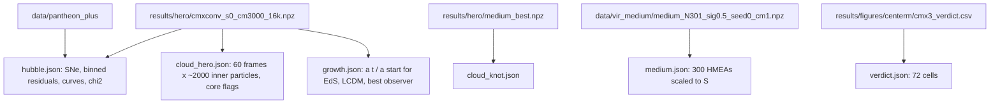

# Explainer video — what every on-screen number is, and where it comes from

Pipeline: [summary.md](./summary.md). Honesty rules: [../practices.md](../practices.md),
[../findings/summary.md](../findings/summary.md) (do-not-claim list applies to the video too).



## Exported (scripts/export_data.py, recomputed with the repo's own engine)
| shown | value | how |
|---|---|---|
| fit score node model | 0.440 | best-observer a(t) of the hero npz → `sim_to_distance_modulus` → `evaluate_precomputed` (matches the npz's stored 0.4400) |
| noise band | ±0.005 around ΛCDM | lode PF28: 8k qualifiers 0.433–0.435, 2k none < 0.436, 16k ~+0.005 ⇒ observer-sampling noise; `NOISE` in `scenes/Data.tsx` |
| fit ΛCDM / EdS | 0.436 / 0.843 | `model_distance_modulus` "lcdm" / "einstein_de_sitter", same engine, all 1580 SNe |
| supernova count | 1580 (1564 in model range) | `load_pantheon()` (z ≥ 0.01, no calibrators) |
| growth ×3.30 / ×3.22 / ×2.83 | ΛCDM / model / EdS | a(13.8)/a(2.9); model = best observer |
| healthy cloud | S = 89 Gpc, knot 1.08, 16000 inner particles | cmxconv_s0_cm3000_16k (PF26 converged candidate) |
| knot cloud | S = 63 Gpc, knot 0.56, fit 0.454 | medium_best (PF22 collapsing core) |
| 68 / 72 universe-like | cmx3 (8k) verdict | qualifies column; cm100/s2 is the runaway (no fit → `null`) |
| HMEAs | 300 nodes, NN spacing = S | relaxed medium, node 0 ("us") dropped, scaled like `_build_medium_virialized_grid` |

Inner (observable) particles are recovered from `pos_centred` by replaying
`sweep.save_snapshots`' subsample (`default_rng(0).choice(n_total, 6000)`; inner = index <
n_inner, n_inner = n_total / (1 + min(centerM−1, 2))). Knot ratio = `_universe_fit_rank` recipe.

```bash
cd video && npm run data     # prints chi2s + "68/72" as a self-check
```

## Narrated round numbers (script.ts) — check against the paper when it changes
- observable radius 14 Gpc ≈ 46 Gly; fiducial node 500 M_obs ≈ 5e55 kg, S ≈ 39 Gpc (paper §estimation)
- 10^120 fine-tuning; dark energy 68 / DM 27 / baryons 5 %
- Hubble tension (Predictions scene): Planck 2018 67.4 ± 0.5 vs SH0ES (Riess 2022) 73.04 ± 1.04 km/s/Mpc, "≈ 8% apart"
- On-screen distances in light-years via `gly()` (1 Gpc = 3.2616 Gly): S = 89 Gpc → 290, 63 → 205, 15 → 49
- Hawking T ≈ 2.5e-33 K at 5e55 kg (paper §defenses, `cosmo.constants.hawking_temperature_K`)
- converged 10k → 100k particles (PF19); centerM range 1 → 3000 (cmx3 grid)

## Deliberately illustrative (labelled or qualitative on screen)
- Hook galaxies, tide/shear diagrams, runaway animation, phantom w(t) curve ("shape
  illustrative"), sky-map dipole / multipoles / flow (paper predictions need re-derivation
  for the medium — [../paper-reference.md](../paper-reference.md)).
- Observer scan cursor hops over random particles; the saved snapshots do NOT identify the
  real best-observer particle, so its fit is shown in a separate card, never pinned to a dot.
- Great Metabolism scene carries a SPECULATIVE stamp and says "no simulation behind this one".
- Beyond scene: "edge of the Big Bang" sphere drawn at 3× the observable radius — illustrative,
  no number on screen (the sim shell extent depends on centerM).

## Invariants
- Never caption the model as beating ΛCDM: the Data scene says "it matches" and that gaps below
  ±0.005 are simulation noise (some 8k runs score 0.433–0.435 < 0.436; that is within noise).
- ΛCDM and EdS references appear next to every model fit score.
- Colours follow the paper: ΛCDM blue, model orange, EdS green.
