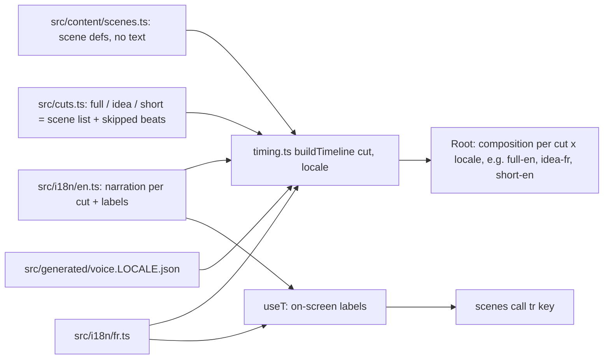

# Explainer video — languages (i18n) and cuts (several videos from one codebase)

One set of scenes renders several videos ("cuts") in several languages. Pipeline:
[summary.md](./summary.md). On-screen numbers: [data-sources.md](./data-sources.md).



## Contracts
- **Cut** = ordered scene ids + optional `skip: {sceneId: [beat, …]}` + format (landscape 1920×1080
  or vertical 1080×1920). Skipped beats get zero duration, so every visual keyed to them collapses;
  scenes are never edited to hide content. The idea cut skips the beats that talk about numbers
  (Martin: "skip the slides that talk about numbers", not a number-hiding flag).
- **Narration lookup**: `narration[cut][sceneId] ?? narration.full[sceneId]` — a cut overrides only
  the lines it rewrites; a scene's beat count is fixed by its visuals, overrides keep it.
- **Labels**: every on-screen string is `tr('scene.key')` (`useT`); missing French keys fall back to English and
  `npm run i18n:check` lists them. Numbers/units go through locale formatters (0,436 ; milliards).
- **Voice per locale**: `public/voice/<locale>/`, manifest `src/generated/voice.<locale>.json`. Clip
  key = `sceneId-beat-hash(spoken)` + settings hash, so the same line in two cuts is voiced once.
  EN: Chatterbox (English model), `voice-ref/martin-en-cut.wav`. FR: Chatterbox Multilingual
  (`chatterbox.mtl_tts`, language "fr"), `voice-ref/martin-fr-cut.wav` (also trimmed to end on a
  full sentence). QA: whisper-base.en for EN, multilingual whisper-base for FR.

## Code
```tsx
const tr = useT();  const fmt = useFmt();  const gly = useGly();   // in a scene component
<Card title={tr('data.legend_sne', {n: fmt(1580)})} />            // "{n} Pantheon+ supernovae (binned)"
fmt(0.436, 3)        // "0.436" en | "0,436" fr (fr-CA)
fmt(v, undefined, false)   // Axes default: digits as written, no thousands grouping (3000 not 3,000)
gly(89, true)        // tr('units.gly_short', {n: 290}) → "290 billion ly"
```
- `useLocale()` → `{locale, cut}` (e.g. TeX that needs a decimal comma: `2{,}5` in fr).
- `src/types.ts`: `SceneSpec` (structure) + `Locale` (`title, subtitle, credits, chapters, whatIf,
  narration: {[cut]: {[sceneId]: string[]}}, labels`) → `resolveScenes(cut, locale)` gives `SceneDef[]`.
- Label keys = `<scene-file>.<slug>` (generated by the one-off codemod `scripts/_extract_labels.mjs`),
  plus shared `units.*`, `shell.*`.
- Compositions: `<cut>-<locale>` in Root.tsx; `node scripts/render.mjs <cut> <locale>` →
  `out/<cut>-<locale>.mp4` (loudnormed). `CUT`/`LOCALE` env for voice.mjs, frames.mjs, stills.mjs,
  voice_check.py. `VOICE_DRY=1` lists clips without generating.
- voice.mjs voices the union of all cuts' non-skipped lines for one locale; `CB_LANGUAGE` joins the
  settings hash only when set, so EN clip names stayed unchanged through the refactor.

## Invariants / lessons
- Refactor guard: EN frame count (20572) + 112 per-beat stills diffed against a pre-refactor
  baseline (`scripts/diff_stills.py`) — 0 differ. Grouping of axis ticks was the one regression found.
- Scene code names the translator `tr` (not `t`: `t` is time in many scenes).
- French typography (OQLF): decimal comma, space thousands (fr-CA), space before « : » only (not
  ; ! ?). `captionTokens` glues a spaced « : » to the previous word with a no-break space, and keeps an
  elision before a highlight as one highlighted word (`l’*énergie sombre*` → « l’énergie sombre »).
  `spokenText` turns ’ into ' for the TTS (EN narration has none, so EN clip hashes didn't move).
- French voice text spells every number out (`{1998|mille neuf cent quatre-vingt-dix-huit}`,
  `{0,436|zéro virgule quatre cent trente-six}`): the multilingual model is less reliable on digits.
- The FR voice (Chatterbox Multilingual cloning `martin-fr-cut.wav`) sounds France-French and deeper
  than Martin; the model's French accent wins over the reference. Kept for now; Martin may dub the
  French himself: record one wav per beat over the same file names in public/voice/fr/, then re-run
  voice.mjs with the same env (existing clips are re-measured, so the visuals re-time to the new takes).
- Translation choices (Martin, 2026-10-21): clumps → « amas »; knot → « nœud » (open question: clashes
  with « nœud progéniteur »); overfitting → « *overfitting*, ou le surajustement » (English term kept, as
  in real French usage); dark flow → « courant noir » (Wikipedia FR); Axis of Evil → « axe du mal »;
  toy model → « modèle-jouet »; HMEA → « AEHM » (attracteur externe hyper-massif); Gyr → « Ga »; the paper
  title stays English (credits). Labels are ~20–30 % longer than EN: check stills for overflow
  (cards with fixed width, docked what-if badge vs. titles, panel subtitles side by side).
- Review sheet: `npm run i18n:review` → `lode/tmp/fr-review.md` (EN | FR per beat, voice text when it differs).

## Cuts (planned)
| cut | format | content |
|---|---|---|
| full | 1920×1080 | today's ~11.5 min explainer |
| idea | 1920×1080 | the idea only: no simulation details, number beats skipped (~5–6 min) |
| short | 1080×1920 | ~45–55 s vertical: existing scenes scaled into the middle, big captions |

## Phases
1. (done) Infrastructure + extract EN strings; EN output must stay identical (frame count + still diffs).
2. French translation draft (Martin reviews: native speaker). 3. French voice + render.
4. Idea cut EN/FR. 5. Short EN/FR.
