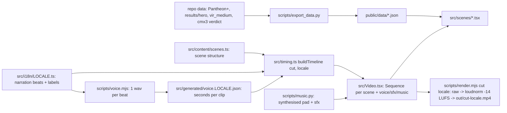

# Explainer video — Remotion pipeline (`video/`)

~11.5 min YouTube-style explainer ("What If Dark Energy Is Just… the Neighbours?"), 1920×1080 @
30 fps, rendered from code with Remotion 4 (React → MP4). Self-contained Node project in
`video/` (own package.json, node_modules gitignored). User guide: `video/README.md`.
On-screen numbers and their sources: [data-sources.md](./data-sources.md). Languages (EN/FR) and
cuts (full / idea / short): [i18n-and-cuts.md](./i18n-and-cuts.md).



## Contracts
- **All words live in `src/i18n/<locale>.ts`** (narration per cut, chapters, what-if questions,
  on-screen labels); structure in `src/content/scenes.ts` (`beats` = count, must equal narration
  length or timing throws). One beat = one caption line = one voice clip. Markup: `*em*`,
  `{shown|spoken}`, `10^120` (caption superscript).
- **Timing derives from audio.** beat dur = clip seconds + `T.beatGap`; silent `''` beats =
  `T.silentBeat`; what-if scenes prepend `T.whatIfIntro`; scene ≥ `minSeconds`. No clip →
  word-count estimate (2.6 words/s). Knobs in `src/constants.ts` (dependency-free, also read
  by `scripts/frames.mjs`).
- **Animations key to beats, never absolute frames**: `useBeats()` → `at(i)`, `p(i,len,off)`
  (eased 0→1), `s(i)` (spring), `on(i)`, `through(i)`; `<Show from until>` fades blocks.
- **Clip cache key** = `sceneId-beat-hash(spokenText)`; voice.mjs regenerates only changed
  lines and deletes orphans. Changing caption-only text (`{shown|…}`) keeps the clip.
- `SceneSpec.scene` → component in `src/scenes/index.ts`; unknown key throws.
- **Cutting room**: removed scenes live in `src/cutting-room.ts` (`CUT_SCENES`, not rendered)
  with components in `src/scenes/cut/` still registered; restore = SceneSpec + text + cut entry.
  Holds the tidal-stretch + 2GMR/S³ equations, "how big/how far" (500 M_obs, 39 Gpc) and the
  shear-matrix / 1/(S−R)² material (cut 2026-10-16 as too long/technical for video 1).
- **Stars** only behind chart/text scenes: `stars: false` on any scene that looks at our
  universe or the attractor swarm from outside (no stars out there). Global bg = gradient only.
- **Pacing**: `T.beatGap` 0.7 s after each line, `T.tail` 1.5 s hold at scene end (viewer digests).
- **Cold open = hook lead-in**: `SceneDef.leadSeconds` adds silent seconds before beat 0 (timing.ts
  folds it into `intro`). The hook uses 8.5 s: swarm centred on an ordinary black attractor (the
  progenitor is NOT special) → it bangs into galaxies → two neighbours swallow them → one swells
  while the view recentres → it bangs on "flying apart" into the expanding galaxy field. No text, no
  bang sfx. (The old standalone teaser with sky montage + text is in the cutting room.)
- sfx: `{beat, sound, offset (s), volume}`; default volume 0.4; what-if whoosh 0.12; no ding.
- Adding a beat mid-scene: renumber the scene's beat refs with `scripts/_shift.py FILE FROM_LINE
  MIN_BEAT +1` (rewrites b.on/p/at/s/through and from/until).
- **Narration style** (for the neural voice): short sentences, real `?`, commas/periods for
  pauses, never `…`; numbers/symbols via `{shown|spoken}` (e.g. `{destabilises|becomes
  unstable}`, `{ΛCDM|Lambda C D M}`); "attractors", never spelled-out "HMEA"; light-years only.
- **Data is imported JSON** (webpack bundles it); re-run `npm run data` after new sims.

```ts
// a scene: animations follow narration beats
const b = useBeats();
<path d={pathOf(partial(modelPts, b.p(6, 40)))} />   // draws during beat 6
<Show from={7}><ChiSquaredBars /></Show>              // appears with beat 7
```

## Pieces
- `components/Space3D.tsx` — canvas 3D scatter (points / glow nodes / sphere), yaw-pitch
  perspective, ONE depth-sorted draw list across all layers (the sphere has a semi-opaque body,
  so attractors behind our universe pass behind it); `cloudAt(frames, f)` interpolates
  snapshot frames; `project()` for labels.
- `Video.tsx` `EndFade` — global fade to black over the last ~1.6 s, 0.6 s of pure black.
- `components/SceneShell.tsx` — fade in/out, chapter label, "WHAT IF…" stamp → docked badge,
  karaoke captions (`Captions.tsx`).
- `components/Chart.tsx` (`scales`, `Axes`, `LegendItem`), `components/ui.tsx` (KaTeX `Tex`
  in display mode + nowrap, `At` = centred & `width: max-content`, `Card`, `Arrow`, `NodeDot`).
- Audio: voice per beat; music loop ducks under speech with an 18-frame ramp; sfx per beat
  (`sfx: [{beat, sound}]`), whoosh on every what-if.
- Review: `node scripts/stills.mjs scene:beat:offset …` renders stills with one bundle and
  tiles them into `out/sheet-*.jpg`; `npm run frames` lists scene/beat frames (both take `CUT` /
  `LOCALE` env). `scripts/diff_stills.py` compares two still dirs (refactor guard).
- Node scripts read the TS sources through `scripts/load-ts.mjs` (`loadTs('timing')`): transpiles
  src/**/*.ts (not scenes/components) to node_modules/.cache/ts, inlines JSON imports.

## Voice engines
- `sapi` (default; offline Windows "Microsoft David Desktop", rate 1) — robotic; only SAPI desktop
  voices (David, Zira) are reachable from System.Speech, not OneCore ones.
- `kokoro` (82M, Apache 2.0; `KOKORO_VOICE` bm_george / am_michael / af_heart, `KOKORO_SPEED`)
  and `chatterbox` (MIT, expressive; `CB_EXAGGERATION`, `CB_CFG`, `CB_PROMPT` = reference wav to
  clone) run `scripts/tts_worker.py` inside `video/.tts-venv` (Python 3.12, CPU torch; needs
  `setuptools<81` because chatterbox's `perth` watermarker imports `pkg_resources`).
- `piper` (`PIPER_MODEL`), `none` (timing from word count).
- Clip filename = `sceneId-beat-hash(spoken)-hash(engine+settings).wav`: switching engines never
  mixes voices; an interrupted neural run resumes (worker writes `.part.wav` then renames).
- `scripts/voice_samples.py` = A/B audition of 3 fixed lines → `out/voice-samples/*.wav`.
- Voice cloning (EN): `CB_PROMPT=voice-ref/martin-en-cut.wav` (Martin's own sample, cut at 19.1 s so it
  ENDS ON A FULL SENTENCE: "…to fix your hiccup."; the uncut 30 s version ends mid-sentence and
  made 2/4 takes end with a rising "unfinished" pitch vs 0/4 with the cut one; loudnormed; `voice-ref/` is gitignored, personal audio never committed; `martin-fr.wav` waits for
  the French version). Current: exaggeration 0.6, CFG 0.3. 0.8/0.35 sounded "stressed" and fast.
- Per-line overrides: `SceneSpec.voice = {beat: {exaggeration, cfg}}` (e.g. "It's speeding up" at
  0.55); caption `*emphasis*` never reaches the voice.
- Pronunciation fixes found by measuring the longest internal pause + Whisper transcript over
  spelling variants: "Lambda CDM" (not "LambdaCDM" → "Land of CDM", not hyphenated), "type 1A"
  (not "type one A" → "one … a"), "supernovas" (not "supernovae"), "point along the same axis"
  (not "line up along"). Bad seeds happen: QA re-rolls them.
- `scripts/voice_check.py --fix`: Whisper (base.en) QA vs. the script, re-rolls mismatches with a
  seed salt. Numbers are normalised with num2words; it flags low similarity (< 0.8), extra words at
  the end (Chatterbox sometimes keeps talking: "…what-if. You can."), inserted/repeated phrases,
  AND unnatural pauses: an energy silence > 0.45 s that Whisper's word timings place after a script
  word with no punctuation ("call … whatever"). Whisper's own word timestamps stretch over
  silences, so gaps must come from the audio energy. It also flags HANGING ENDINGS: a line ending
  in '.'/'!' whose pitch (pyin) over the final voiced 0.5 s doesn't fall (slope > −3 st/s). Pauses vary by seed; punctuation steers them
  (a colon before a reveal: "doing this: dark energy"; never a comma inside "one followed by…").
  Always run it before rendering.
- Rejected: Breeze TTS 2 — CUDA-only per its model card and weights/outputs non-commercial.
- Generated audio (`public/voice`, `public/audio`) is gitignored; a fresh clone runs
  `LOCALE=<l> npm run voice && npm run music` before rendering. `src/generated/voice.<locale>.json`
  (timing) is committed; clips live in `public/voice/<locale>/`.

## Lessons learned
- Python edits on Windows: always `encoding='utf-8'` + write to a temp file then `os.replace`;
  a failed cp1252 write truncated a source file to 0 bytes. Helper: `video/scripts/_edit.py`.
- KaTeX inline mode wraps at relations inside narrow centred boxes → use display mode + nowrap.
- Absolutely centred boxes shrink-to-fit and wrap titles → `width: max-content` in `At`.
- A μ(z) plot hides the dark-energy signal; residual plots (vs EdS for 1998, vs ΛCDM for the
  model) make it visible.
- Render speed ≈ 10 fps on this machine (full video ≈ 30 min); Remotion downloads its own
  Chrome Headless Shell on first render.
