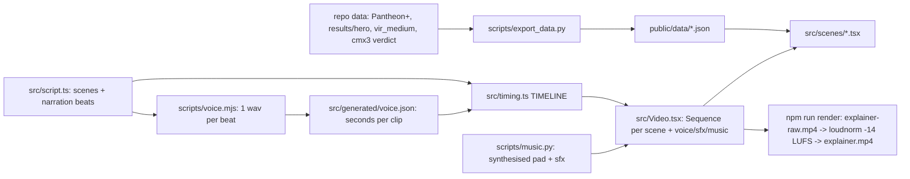

# Explainer video — Remotion pipeline (`video/`)

~10 min YouTube-style explainer ("What If Dark Energy Is Just… the Neighbours?"), 1920×1080 @
30 fps, rendered from code with Remotion 4 (React → MP4). Self-contained Node project in
`video/` (own package.json, node_modules gitignored). User guide: `video/README.md`.
On-screen numbers and their sources: [data-sources.md](./data-sources.md).



## Contracts
- **script.ts is the only place narration lives.** One beat = one caption line = one voice
  clip. Markup: `*em*`, `{shown|spoken}`, `10^120` (caption superscript).
- **Timing derives from audio.** beat dur = clip seconds + `T.beatGap`; silent `''` beats =
  `T.silentBeat`; what-if scenes prepend `T.whatIfIntro`; scene ≥ `minSeconds`. No clip →
  word-count estimate (2.6 words/s). Knobs in `src/constants.ts` (dependency-free, also read
  by `scripts/frames.mjs`).
- **Animations key to beats, never absolute frames**: `useBeats()` → `at(i)`, `p(i,len,off)`
  (eased 0→1), `s(i)` (spring), `on(i)`, `through(i)`; `<Show from until>` fades blocks.
- **Clip cache key** = `sceneId-beat-hash(spokenText)`; voice.mjs regenerates only changed
  lines and deletes orphans. Changing caption-only text (`{shown|…}`) keeps the clip.
- Scene key in script.ts → component in `src/scenes/index.ts`; unknown key throws.
- **Cutting room**: removed scenes live in `src/cutting-room.ts` (`CUT_SCENES`, not rendered)
  with components in `src/scenes/cut/` still registered; restore = move the def into `SCENES`.
  Holds the tidal-stretch + 2GMR/S³ equations, "how big/how far" (500 M_obs, 39 Gpc) and the
  shear-matrix / 1/(S−R)² material (cut 2026-10-16 as too long/technical for video 1).
- **Narration style** (for the neural voice): short sentences, real `?`, commas/periods for
  pauses, never `…`; numbers/symbols via `{shown|spoken}` (e.g. `{destabilises|becomes
  unstable}`, `{ΛCDM|Lambda C D M}`); "attractors", never spelled-out "HMEA"; light-years only.
- **Data is imported JSON** (webpack bundles it); re-run `npm run data` after new sims.

```ts
// a scene: animations follow narration beats
const b = useBeats();
<path d={pathOf(partial(modelPts, b.p(6, 40)))} />   // draws during beat 6
<Show from={7}><ChiSquaredBars /></Show>              // appears with beat 7
```

## Pieces
- `components/Space3D.tsx` — canvas 3D scatter (points / glow nodes / sphere), yaw-pitch
  perspective, ONE depth-sorted draw list across all layers (the sphere has a semi-opaque body,
  so attractors behind our universe pass behind it); `cloudAt(frames, f)` interpolates
  snapshot frames; `project()` for labels.
- `Video.tsx` `EndFade` — global fade to black over the last ~1.6 s, 0.6 s of pure black.
- `components/SceneShell.tsx` — fade in/out, chapter label, "WHAT IF…" stamp → docked badge,
  karaoke captions (`Captions.tsx`).
- `components/Chart.tsx` (`scales`, `Axes`, `LegendItem`), `components/ui.tsx` (KaTeX `Tex`
  in display mode + nowrap, `At` = centred & `width: max-content`, `Card`, `Arrow`, `NodeDot`).
- Audio: voice per beat; music loop ducks under speech with an 18-frame ramp; sfx per beat
  (`sfx: [{beat, sound}]`), whoosh on every what-if.
- Review: `node scripts/stills.mjs scene:beat:offset …` renders stills with one bundle and
  tiles them into `out/sheet-*.jpg`; `npm run frames` lists scene/beat frames.

## Voice engines
- `sapi` (default; offline Windows "Microsoft David Desktop", rate 1) — robotic; only SAPI desktop
  voices (David, Zira) are reachable from System.Speech, not OneCore ones.
- `kokoro` (82M, Apache 2.0; `KOKORO_VOICE` bm_george / am_michael / af_heart, `KOKORO_SPEED`)
  and `chatterbox` (MIT, expressive; `CB_EXAGGERATION`, `CB_CFG`, `CB_PROMPT` = reference wav to
  clone) run `scripts/tts_worker.py` inside `video/.tts-venv` (Python 3.12, CPU torch; needs
  `setuptools<81` because chatterbox's `perth` watermarker imports `pkg_resources`).
- `piper` (`PIPER_MODEL`), `none` (timing from word count).
- Clip filename = `sceneId-beat-hash(spoken)-hash(engine+settings).wav`: switching engines never
  mixes voices; an interrupted neural run resumes (worker writes `.part.wav` then renames).
- `scripts/voice_samples.py` = A/B audition of 3 fixed lines → `out/voice-samples/*.wav`.
- Rejected: Breeze TTS 2 — CUDA-only per its model card and weights/outputs non-commercial.
- Generated audio (`public/voice`, `public/audio`) is gitignored; a fresh clone runs
  `npm run voice && npm run music` before rendering. `src/generated/voice.json` (timing) is committed.

## Lessons learned
- Python edits on Windows: always `encoding='utf-8'` + write to a temp file then `os.replace`;
  a failed cp1252 write truncated a source file to 0 bytes. Helper: `video/scripts/_edit.py`.
- KaTeX inline mode wraps at relations inside narrow centred boxes → use display mode + nowrap.
- Absolutely centred boxes shrink-to-fit and wrap titles → `width: max-content` in `At`.
- A μ(z) plot hides the dark-energy signal; residual plots (vs EdS for 1998, vs ΛCDM for the
  model) make it visible.
- Render speed ≈ 10 fps on this machine (full video ≈ 30 min); Remotion downloads its own
  Chrome Headless Shell on first render.
